# AMLgsMenu 与 AMLDigitalFPV 运行流程图

本文档基于源码逐行梳理两个核心进程的完整执行流程。
- AMLgsMenu 源码:`github.com/imagemlt/AMLgsMenu`(打包于 `packages/multimedia/amlgsmenu`)
- AMLDigitalFPV 源码:`github.com/imagemlt/AMLDigitalFPV`(打包于 `packages/multimedia/amldigitalfpv`)

---

## 一、AMLgsMenu(OSD 菜单进程)

### 1.1 启动引导(systemd → 进程就绪)

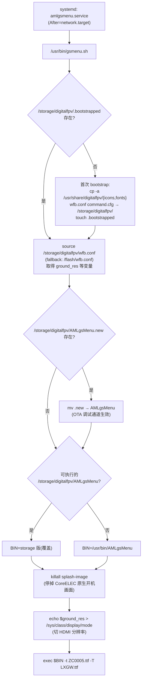

### 1.2 进程初始化(main → Initialize,顺序执行)

```mermaid
flowchart TD
    A["main (main.cpp:22)"] --> B["getopt 解析<br/>-t UI字体 -T 终端字体 -m mock<br/>-p mavlink端口(默认14452)<br/>-c command.cfg -f wfb.conf"]
    B --> C["setpriority +5<br/>(让出 CPU 给视频解码)"]
    C --> D["Application::Initialize (application.cpp:244)"]

    D --> E1["① display_platform_.Initialize()<br/>打开 fbdev + EGL/GLES2 上下文<br/>失败→退出"]
    E1 --> E2["② InputController::Initialize()<br/>libinput + udev 枚举<br/>鼠标/键盘/手柄/触摸屏<br/>ScanJoysticks()"]
    E2 --> E3["③ command_templates_.LoadFromFile()<br/>解析 command.cfg 自定义命令模板"]
    E3 --> E4["④ CommandExecutor 启动后台线程<br/>(Shell 队列 + Remote 队列)"]
    E4 --> E5["⑤ ImGui 初始化<br/>CreateContext + StyleColorsDark<br/>加载 UI 字体(ZC0005 时 26px 否则 31px)<br/>加载终端字体<br/>ImGui_ImplOpenGL3_Init(#version 100)"]
    E5 --> E6["⑥ Terminal(内嵌交互终端)<br/>SignalMonitor<br/>TelemetryWorker::Start()<br/>(独立线程:wfb 信号/码率/HID电量/WiFi监控)"]
    E6 --> E7["⑦ 视频模式表<br/>DefaultSkyModes()<br/>LoadHdmiModes(/sys/class/amhdmitx0/disp_cap)<br/>失败→fallback 1080p60<br/>无 120Hz→补 1080p120/720p120"]
    E7 --> E8["⑧ MenuState 创建(全部设置项状态机)"]
    E8 --> E9["⑨ EnsureWritableConfig + LoadConfig<br/>读 /storage/digitalfpv/wfb.conf"]
    E9 --> E10["⑩ RebuildTransport(firmware_type, ap_mode)<br/>AP模式→SSH transport(远端)<br/>普通→UDP/本地 transport"]
    E10 --> E11["⑪ LinkSettingsController<br/>hooks: AcquireTransport /<br/>CmdRunner.EnqueueRemote / EnqueueShell"]
    E11 --> E12["⑫ RemoteSyncService::Start()<br/>周期从天空端拉取链路参数<br/>(channel/bandwidth/power…)"]
    E12 --> E13["⑬ MavlinkReceiver::Start()<br/>绑定 UDP :14452 收 MAVLink<br/>(mock 模式跳过)"]
    E13 --> E14["⑭ TelemetryProvider lambda:<br/>MAVLink 姿态/电压/GPS<br/>+ TelemetryWorker 快照合并<br/>(地面信号/温度/码率/HID电量)<br/>首次地面信号→RestartRemoteSync<br/>码率>0→RequestIdrFrame"]
    E14 --> E15["⑮ MenuRenderer 创建(注入 provider+回调:<br/>终端开关/固件更新/重启/WiFi配网)"]
    E15 --> E16["⑯ splash_player_.Init()<br/>解压 40 帧 448×448 动画→GLES 纹理"]
    E16 --> E17["⑰ 输入回调注册:<br/>右键/X/Alt/手势→ToggleMenu<br/>菜单开→命令执行器联动"]
    E17 --> E18["⑱ MenuState::SetOnChangeCallback<br/>设置项→SaveConfig+Apply*<br/>(见 1.4)"]
    E18 --> F["进入主循环 Run()"]
```

### 1.3 主循环(Run,每帧)

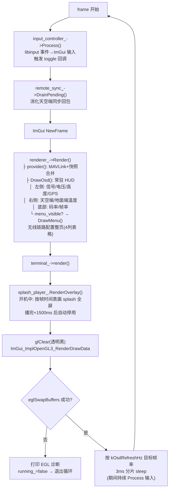

### 1.4 设置项修改流(用户改参数后发生什么)

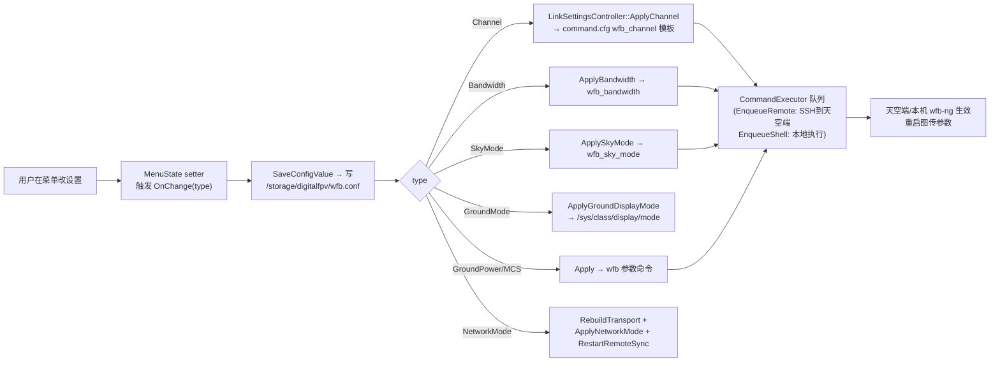

### 1.5 线程模型

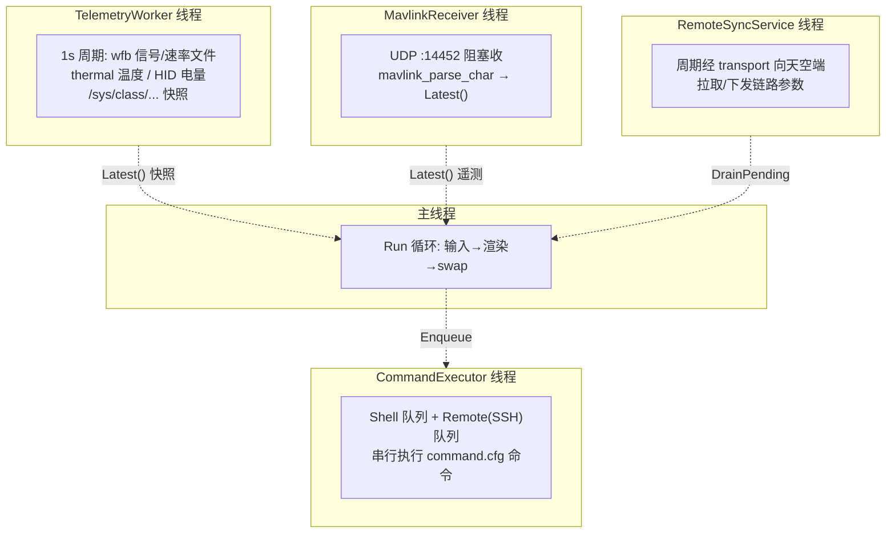

---

## 二、AMLDigitalFPV(视频接收解码进程)

### 2.1 启动引导

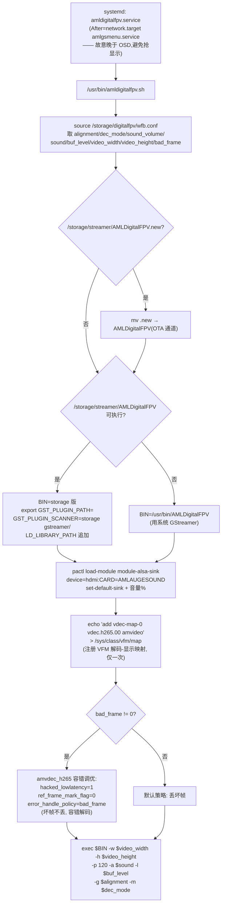

### 2.2 进程初始化(main)

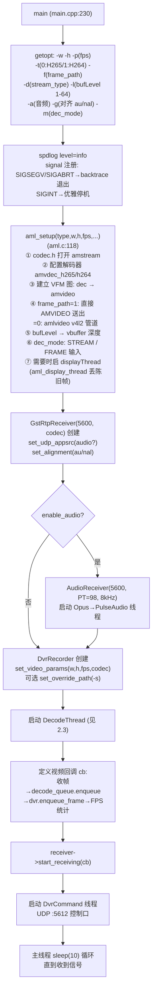

### 2.3 数据面流水线(运行时核心,多线程)

```mermaid
flowchart LR
    subgraph NET["wfb-ng(链路层)"]
        W["WiFi monitor 收包<br/>解密/聚合 → UDP 转发"]
    end

    subgraph GSTP["GStreamer 管道 (gst_parse_launch)"]
        direction LR
        U["udpsrc port=5600<br/>buffer-size 大缓冲<br/>caps: x-rtp H265 PT97<br/>clock-rate 90000"]
        DEP["rtph265depay"]
        PS["h265parse<br/>config-interval=-1"]
        CAPS["capsfilter:<br/>byte-stream +<br/>alignment=au|nal"]
        SK["appsink drop=true<br/>name=out_appsink"]
        U --> DEP --> PS --> CAPS --> SK
    end

    W -->|"RTP"| U

    subgraph PULL["GstThread (pull-samples, RT优先级)"]
        CB["cb(frame):<br/>bytes统计<br/>decode_queue.enqueue<br/>dvr.enqueue_frame<br/>录影时 500ms FPS 窗口估算"]
    end
    SK -->|"pull_sample"| CB

    subgraph DEC["DecodeThread (RT-MID 优先级)"]
        Q["moodycamel<br/>BlockingConcurrentQueue<br/>wait_dequeue"]
        SUB["aml_submit_decode_unit()<br/>→ amvdec_h265 硬解"]
        Q --> SUB
    end
    CB -->|"无锁队列"| Q

    SUB --> VFMX["Amlogic VFM<br/>vdec.h265.00 → amvideo"]
    VFMX --> HDMI["HDMI 视频层输出"]

    subgraph DISP["displayThread(仅 amlvideo 路径)"]
        DT["检测积压→跳过陈旧帧<br/>逐帧送显"]
    end
    VFMX -.-> DT -.-> HDMI

    W -->|"PT=98 音频<br/>(appsrc 分流)"| AUD["AudioReceiver:<br/>rtpdepay→opusdec→<br/>PulseAudio hdmi_out"]
    AUD --> HDMI
```

### 2.4 DVR / 音频控制回路(UDP :5612)

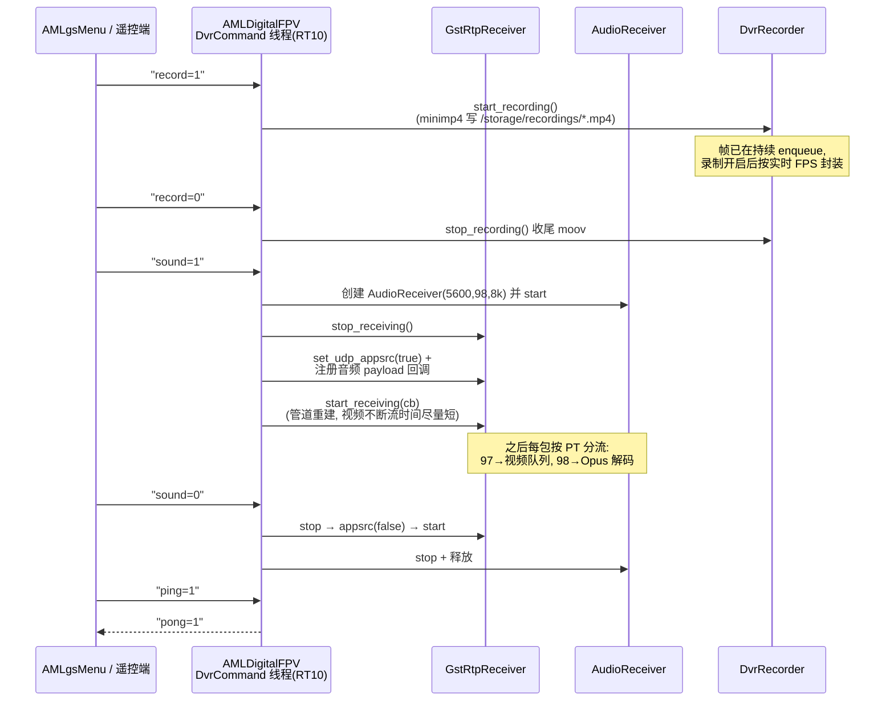

### 2.5 停机与异常路径

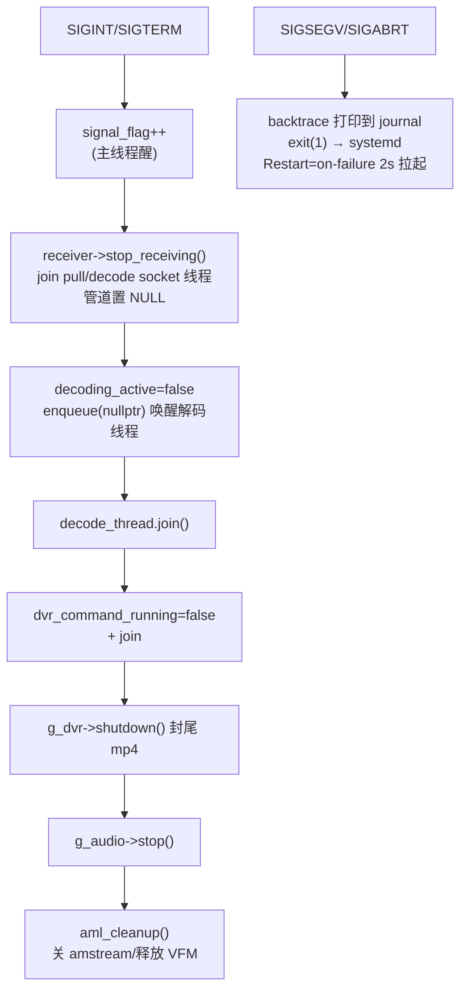

---

## 三、两进程协作关系(开机时间线)

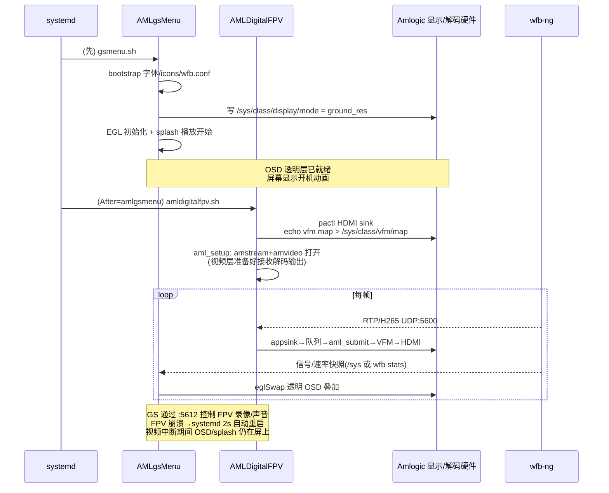

## 四、关键参数传递链(wfb.conf 为中心)

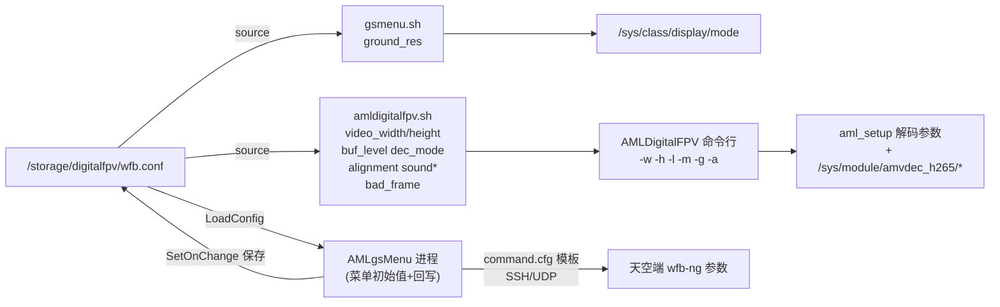
