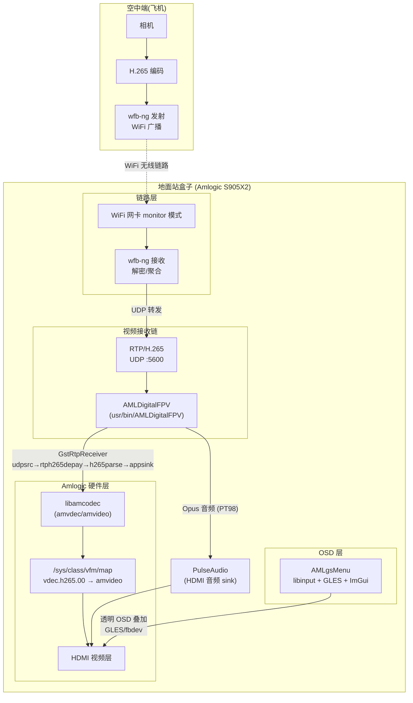
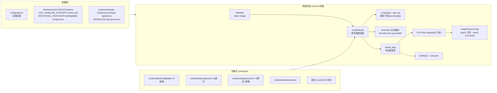
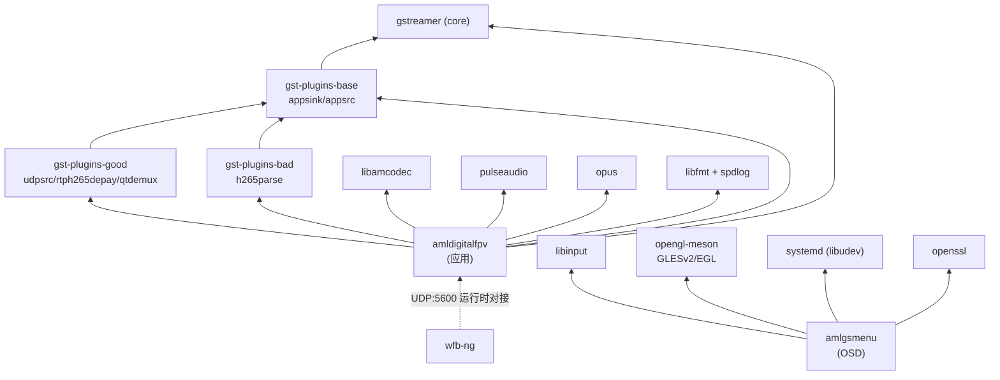
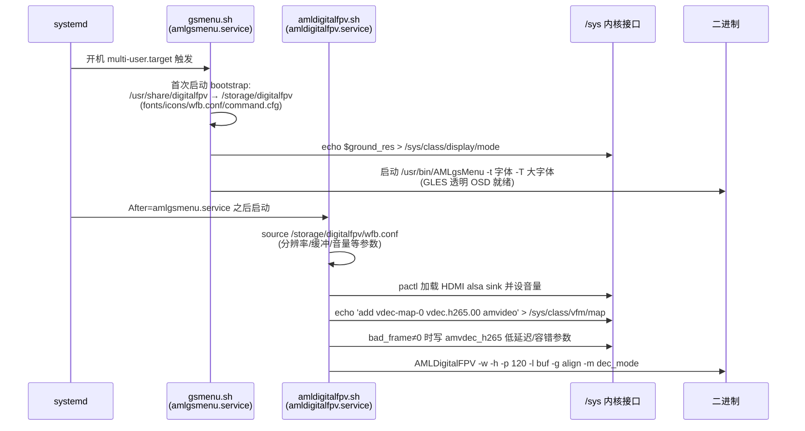
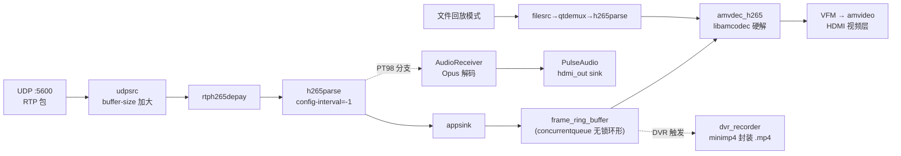
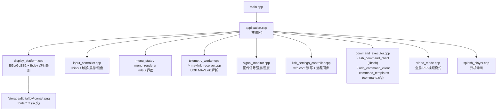
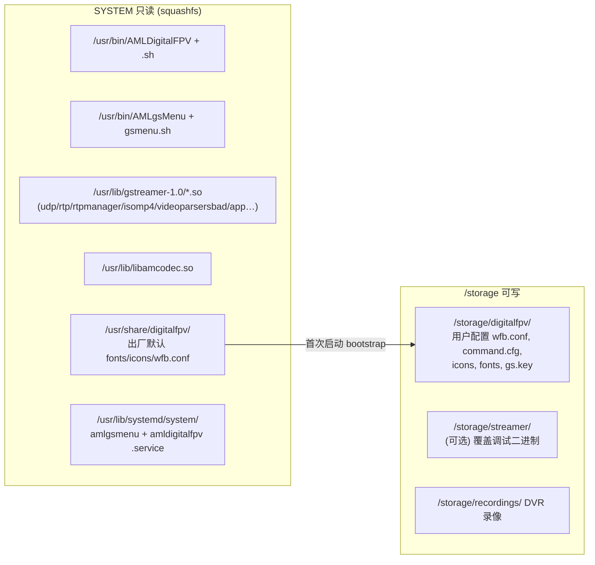
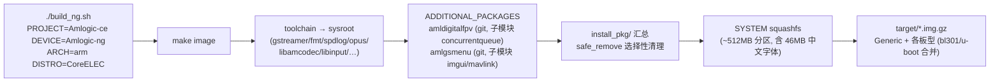

# CoreELEC_FPV 项目架构总览

本项目基于 **CoreELEC 21(Amlogic-ng / arm)** 构建系统,定制开发面向
**FPV 数字图传地面站** 的完整固件:接收飞机端 wfb-ng 发出的 RTP/H.265 视频流,
硬件解码后 HDMI 输出,并叠加透明 OSD 菜单(MAVLink 遥测、链路参数配置)。

产出的可刷写镜像:`target/CoreELEC-Amlogic-ng.arm-<ver>-Generic.img.gz`
(刷机方法见 [刷机指南.md](刷机指南.md),编译方法见根目录 `BUILD_FPV.md`)

---

## 1. 系统总体架构

## 2. CoreELEC 构建系统分层

## 3. 核心模块一览

| 模块 | 位置 | 语言/框架 | 职责 |
|---|---|---|---|
| **AMLDigitalFPV** | `packages/multimedia/amldigitalfpv` | C++17 + CMake,GStreamer | 视频/音频接收解码主体:RTP H.265 → amcodec 硬解 → HDMI;DVR 录像;延迟统计 |
| **AMLgsMenu** | `packages/multimedia/amlgsmenu` | C++ + libinput + GLES2 + Dear ImGui | 透明 OSD 菜单:遥测显示(MAVLink)、图传参数配置、命令执行(SSH/UDP)、图标/中文字体渲染 |
| **gst-plugins-good** | `packages/multimedia/gstreamer/gst-plugins-good` | meson | 提供 `udpsrc`/`rtph265depay`/`rtpmanager`/`qtdemux`/`v4l2` 元素(**本项目新增**) |
| **gst-plugins-base** | `packages/multimedia/gstreamer/gst-plugins-base` | meson | 提供 `appsink`/`appsrc`/视频音频基础插件(**修复:原 safe_remove 误删整个 install_pkg**) |
| **gst-plugins-bad** | `packages/multimedia/gstreamer/gst-plugins-bad` | meson | 提供 `h265parse`(videoparsers) |
| **libamcodec** | `packages/multimedia/libamcodec` | Amlogic 闭源+头文件 | 硬件编解码:`amvdec_h265` 解码器、amvideo 输出、codec.h/amports |
| **wfb-ng(链路层)** | `packages/multimedia/wfb-ng` | — | WiFi Broadcast 图传协议,解密聚合后向本机 UDP:5600 转发(需单独配 `gs.key`) |
| **opengl-meson** | `packages/graphics/opengl-meson` | Amlogic blob | 提供 libEGL/libGLESv2(AMLgsMenu 渲染后端) |
| **启动脚本/服务** | 各包 `scripts/` + `system.d/` | bash + systemd | 见 §5 |

## 4. 模块依赖关系

## 5. 启动与服务流程

> 两个服务均为 `Restart=on-failure`;`/storage/streamer/AMLDigitalFPV` 与
> `/storage/digitalfpv/AMLgsMenu` 若存在则**优先于内置二进制**(免重刷 OTA 调试通道)。

## 6. 视频接收数据流(AMLDigitalFPV 内部)

关键设计:
- **零拷贝送解码**:appsink 取帧后直接写 amcodec,不走软件编码中转;
- **低延迟**:`buf_level` 控制环形缓冲深度;`dec_mode` 选择解码策略;
  `hacked_lowlatency`/`error_handle_policy` 内核参数处理坏帧(丢帧或容错);
- **DVR**:`minimp4.h` 单头文件封装,录像写 `/storage/recordings`;
- **遥测联动**:AMLgsMenu 通过 UDP 把 OSD 状态/命令与 AMLDigitalFPV 及远端交互。

## 7. OSD 菜单模块结构(AMLgsMenu)

## 8. 运行时文件布局

## 9. 构建流水线

注意点(历史踩坑):
1. `GET_HANDLER_SUPPORT` 需含 `git`,否则 `.git` 源包无法下载;
2. gst 系列包**不能** `safe_remove ${INSTALL}`(会清空 install_pkg 导致镜像缺 GStreamer);
3. 交叉编译 cmake 包需显式 `-DCMAKE_SYSROOT`(构建环境不导出 `SYSROOT_PREFIX`);
4. `pre_configure_target` 中不要 `cd ${PKG_BUILD}`,否则 cmake 退化为源码树内构建。
