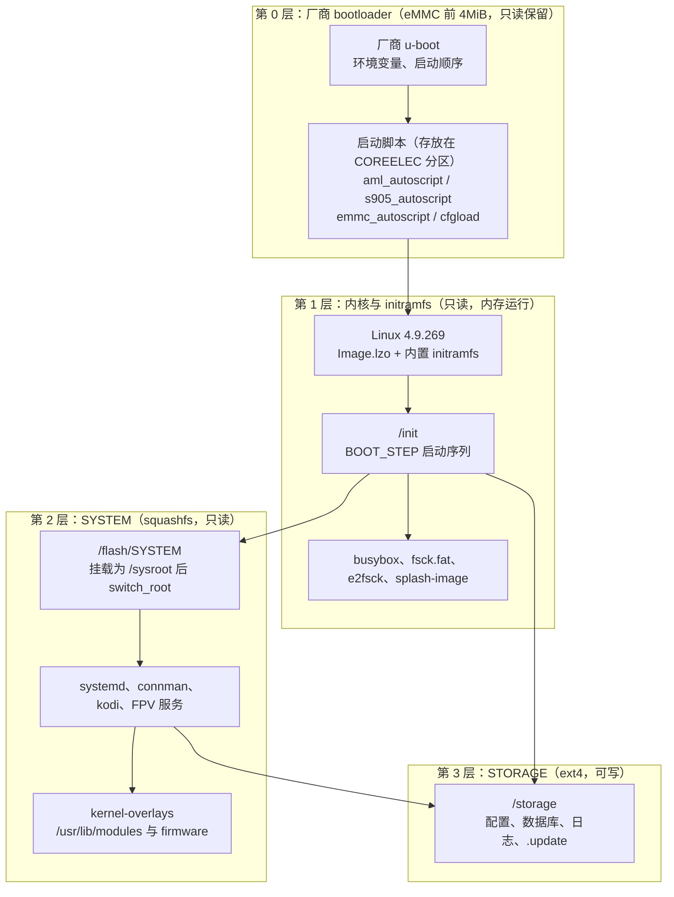
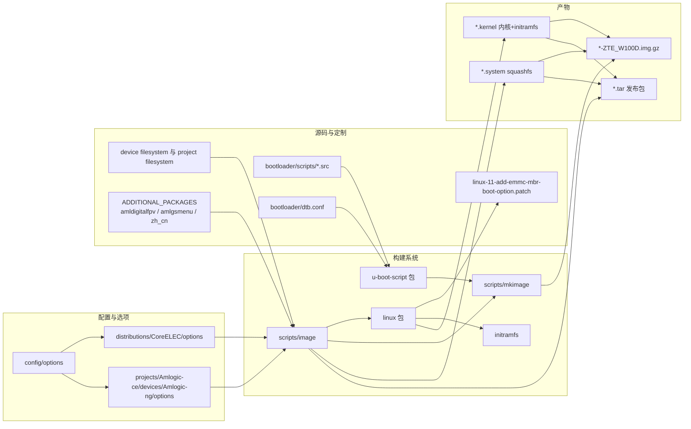
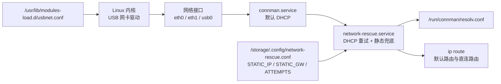

# 项目架构总览

本文给出 CoreELEC_FPV 仓库的整体架构：项目定位、目录职责、分层模型、关键定制点、构建系统与产物。目标硬件为 **ZTE W100D（Amlogic S905X2 / G12A，2G DDR4，eMMC，保留厂商 u-boot）**。

相关文档：

- [刷机教程](flashing-guide.md)
- [项目流程模型图](workflow-diagrams.md)

---

## 1. 项目定位

本仓库是 **CoreELEC 21.2-Omega（Amlogic-ce / Amlogic-ng）** 的定制分支：

- 基线：CoreELEC 21.2-Omega，Amlogic-ng 设备，Linux 4.9.269（`LINUX="amlogic-4.9"`）。
- 目标板型：新增子设备 `ZTE_W100D`，使用设备树 `g12a_s905x2_2g.dtb`。
- 启动方式：保留厂商 u-boot，不写入 CoreELEC 自带 u-boot；通过标准 MBR + `emmc_mbr=1` 让 Linux 忽略 Amlogic MPT。
- 应用层：在标准 Kodi 之上集成 FPV 图传/地面站相关组件（`amldigitalfpv`、`amlgsmenu`），并内置简体中文语言包。
- 可靠性：新增 `network-rescue` 有线网络兜底、`install2emmc` eMMC 安装工具、启动早期钩子 `post-flash.sh`/`post-sysroot.sh`。

---

## 2. 目录结构

### 2.1 关键目录与文件

| 路径 | 作用 |
| --- | --- |
| `build_ng_w100d.sh` | 只构建 ZTE_W100D 的入口脚本，等价于导出 `PROJECT/DEVICE/ARCH/DISTRO/SUBDEVICES_FILTER` 后执行 `make image` |
| `config/options` | 构建系统主配置加载器，按 distro → project → device 顺序合并 options |
| `distributions/CoreELEC/options` | 发行版级配置：`SYSTEM_SIZE=512`、`SYSTEM_PART_START=8192`、`ADDITIONAL_PACKAGES` 等 |
| `distributions/CoreELEC/version` | 版本：`21.2`，代号 `Omega` |
| `projects/Amlogic-ce/devices/Amlogic-ng/options` | 设备级配置：`LINUX="amlogic-4.9"`、`KERNEL_TARGET="Image.lzo"`、`SQUASHFS_COMPRESSION="lzo"`、`SUBDEVICES` 列表 |
| `projects/Amlogic-ce/devices/Amlogic-ng/linux/linux.aarch64.conf` | 内核配置（4.9.269），含 USB 网卡、amcodec 等 |
| `projects/Amlogic-ce/devices/Amlogic-ng/patches/linux/` | 设备内核补丁，含 `linux-11-add-emmc-mbr-boot-option.patch` |
| `projects/Amlogic-ce/devices/Amlogic-ng/bootloader/` | u-boot 脚本源、`config.ini`、`dtb.conf`、`update.sh`、镜像生成钩子 `mkimage` |
| `projects/Amlogic-ce/devices/Amlogic-ng/bootloader/scripts/` | `*.src` u-boot 脚本源，构建时由 `mkimage -T script` 编译为 `*_autoscript`、`*_cfgload` |
| `projects/Amlogic-ce/devices/Amlogic-ng/filesystem/usr/bin/install2emmc` | eMMC 安装工具 |
| `projects/Amlogic-ce/devices/Amlogic-ng/initramfs/platform_init` | initramfs 平台初始化：显示模式、framebuffer 几何、HDMI 使能 |
| `projects/Amlogic-ce/devices/Amlogic-ng/packages/u-boot/package.mk` | u-boot 包；`ZTE_W100D` 被显式跳过，不构建/不写入 u-boot |
| `projects/Amlogic-ce/filesystem/usr/bin/network-rescue.sh` | 有线网络 DHCP 重试与静态兜底 |
| `projects/Amlogic-ce/filesystem/usr/lib/systemd/system/network-rescue.service` | 网络兜底服务单元 |
| `projects/Amlogic-ce/filesystem/usr/lib/modules-load.d/usbnet.conf` | 预加载 USB 网卡驱动 |
| `packages/sysutils/busybox/scripts/init` | initramfs 主启动脚本（BOOT_STEP 序列、`switch_root`） |
| `packages/multimedia/amldigitalfpv/` | FPV 视频接收程序与 systemd 单元 |
| `packages/multimedia/amlgsmenu/` | OSD/配置菜单、默认 `wfb.conf`、`command.cfg`、图标与中文字体 |
| `packages/mediacenter/kodi-binary-addons/resource.language.zh_cn/` | Kodi 简体中文语言包 |
| `scripts/image` | 主镜像构建脚本：安装包、生成 squashfs、发布目录、调用 `scripts/mkimage` |
| `scripts/mkimage` | 生成整盘 `.img`：MBR、FAT p1、ext4 p2、写入启动文件、`pigz --best`、sha256 |
| `target/` | 构建产物：`*.img.gz`、`*.kernel`、`*.system`、`*.tar`、校验文件 |
| `build.CoreELEC-Amlogic-ng.arm-21/` | 构建工作目录：源码、toolchain、install_pkg、image/system、initramfs |

### 2.2 目录结构图

```mermaid
flowchart TB
    ROOT["CoreELEC_FPV/"]

    ROOT --> BUILD["build_ng_w100d.sh"]
    ROOT --> CONFIG["config/options"]
    ROOT --> DIST["distributions/CoreELEC/"]
    ROOT --> PROJ["projects/Amlogic-ce/"]
    ROOT --> PKGS["packages/"]
    ROOT --> SCRIPTS["scripts/image, scripts/mkimage"]
    ROOT --> TARGET["target/"]
    ROOT --> BD["build.CoreELEC-Amlogic-ng.arm-21/"]

    DIST --> DOPT["options<br/>SYSTEM_SIZE=512<br/>ADDITIONAL_PACKAGES"]
    DIST --> DVER["version<br/>21.2 Omega"]

    PROJ --> DEV["devices/Amlogic-ng/"]
    PROJ --> PFS["filesystem/<br/>network-rescue, usbnet.conf"]

    DEV --> OPT["options<br/>LINUX, SUBDEVICES, SQUASHFS"]
    DEV --> LIN["linux/linux.aarch64.conf"]
    DEV --> PAT["patches/linux/<br/>linux-11-add-emmc-mbr-boot-option.patch"]
    DEV --> BOOT["bootloader/<br/>config.ini, dtb.conf, update.sh, mkimage, scripts/*.src"]
    DEV --> INITFS["initramfs/platform_init"]
    DEV --> I2E["filesystem/usr/bin/install2emmc"]
    DEV --> UB["packages/u-boot/package.mk"]
    DEV --> KODI["kodi/guisettings.xml, appliance.xml"]

    PKGS --> FPV["multimedia/amldigitalfpv/"]
    PKGS --> GSM["multimedia/amlgsmenu/"]
    PKGS --> LANG["mediacenter/kodi-binary-addons/resource.language.zh_cn/"]
    PKGS --> BB["sysutils/busybox/scripts/init"]

    TARGET --> IMG["*-ZTE_W100D.img.gz"]
    TARGET --> KERNEL["*.kernel"]
    TARGET --> SYSTEM["*.system"]
    TARGET --> TAR["*.tar"]

    BD --> WIMAGE["image/system<br/>squashfs 源目录"]
    BD --> WINIT["initramfs/<br/>initramfs.cpio"]
    BD --> WTOOL["toolchain/"]
```



---

## 3. 分层架构

系统按启动顺序与可写性分为四层。

### 3.1 分层图



### 3.2 各层职责

| 层 | 存储位置 | 可写性 | 职责 |
| --- | --- | --- | --- |
| bootloader 层 | eMMC 前 4MiB（u-boot）+ `COREELEC` 分区根目录（脚本） | u-boot 区只读保留；脚本可替换 | 选择启动介质、加载 `cfgload`、拼接 bootargs、加载 `kernel.img`/`dtb.img`、`bootm` |
| initramfs 层 | 内核内置 cpio，解压到内存 | 临时 | 加载模块、fsck、挂载 `/flash`/`/storage`、挂载 `/sysroot`、处理升级、`switch_root` |
| SYSTEM 层 | `/flash/SYSTEM`（squashfs） | 只读，loop 挂载 | 完整根文件系统：systemd、connman、Kodi、FPV 组件、内核模块 overlay |
| STORAGE 层 | `STORAGE` 分区（ext4） | 可写 | 用户配置、Kodi 数据库、日志、`/storage/.update` 升级包、`/storage/digitalfpv` 运行数据 |

### 3.3 挂载关系

```text
eMMC p1 (vfat, COREELEC)  ->  /flash          （initramfs 以 ro,noatime 挂载）
        /flash/SYSTEM      ->  /sysroot        （ro,loop，squashfs）
eMMC p2 (ext4, STORAGE)   ->  /storage        （rw,noatime）
switch_root 后：
        /sysroot           ->  /
        /flash             ->  /flash
        /storage           ->  /storage
```

---

## 4. 关键定制点清单

| 定制点 | 关键文件 | 说明 |
| --- | --- | --- |
| `emmc_mbr` 内核选项 | `projects/Amlogic-ce/devices/Amlogic-ng/patches/linux/linux-11-add-emmc-mbr-boot-option.patch` | 在 `block/partition-generic.c` 与 `drivers/amlogic/mmc/emmc_partitions.c` 中检测 `strstr(saved_command_line, "emmc_mbr=1")`，跳过 MPT 校验与 MPT 覆盖 MBR |
| ZTE_W100D 子设备 | `projects/Amlogic-ce/devices/Amlogic-ng/options`、`bootloader/dtb.conf` | `SUBDEVICES` 增加 `ZTE_W100D`；`dtb.conf` 将 `ZTE_W100D` 映射到 `g12a_s905x2_2g.dtb` |
| 厂商 u-boot 保留 | `projects/Amlogic-ce/devices/Amlogic-ng/packages/u-boot/package.mk` | `ZTE_W100D` 不依赖、不安装 `u-boot-ZTE_W100D`，避免覆盖厂商 bootloader |
| eMMC 启动脚本 | `bootloader/scripts/emmc_autoscript.src` | 设置 `device/devnr/partnr=1`、`ce_on_emmc=no`、`emmcmbr_opt=emmc_mbr=1`，`run storeargs` 后执行 `cfgload` |
| SD/USB 兼容脚本 | `bootloader/scripts/s905_autoscript.src` | 兼容只扫描 `s905_autoscript` 的厂商 u-boot，同样转交 `cfgload` |
| 标准启动脚本 | `bootloader/scripts/aml_autoscript.src` | 定义 `bootfromsd`、`bootfromusb`、`bootfromemmc` 与 `bootcmd`，是 CoreELEC 常规入口 |
| 板级 cfgload | `bootloader/scripts/ZTE_W100D_cfgload.src` | 默认 `vout=1080p60hz`、`hdmitx=rgb,8bit`、`console=ttyS0,115200`（无 `tty0`），拼接 `emmcmbr_opt` |
| u-boot 脚本编译 | `projects/Amlogic-ce/packages/tools/u-boot-script/package.mk` | 遍历 `bootloader/scripts/*.src`，用 `mkimage -A <arch> -O linux -T script -C none` 编译 |
| eMMC 安装 | `projects/Amlogic-ce/devices/Amlogic-ng/filesystem/usr/bin/install2emmc` | 备份 4MiB u-boot 与 36MiB MPT，重建 MBR，p1 从 1000MiB 开始，复制系统与存储，恢复 MPT |
| 网络兜底 | `projects/Amlogic-ce/filesystem/usr/bin/network-rescue.sh`、`.../network-rescue.service` | connman DHCP 失败时用 busybox udhcpc 探测，失败则应用静态地址，并持续清理无网关路由 |
| USB 网卡预加载 | `projects/Amlogic-ce/filesystem/usr/lib/modules-load.d/usbnet.conf` | `r8152`、`cdc_ether`、`cdc_eem`、`cdc_ncm`、`asix`、`ax88179_178a`、`smsc75xx`、`smsc95xx`、`lan78xx`、`rndis_host` |
| FPV 视频接收 | `packages/multimedia/amldigitalfpv/` | `amldigitalfpv.service` 调用 `scripts/amldigitalfpv.sh`，读取 `wfb.conf`，配置 ALSA/amcodec，运行 `AMLDigitalFPV` |
| FPV 地面站菜单 | `packages/multimedia/amlgsmenu/` | `amlgsmenu.service` 调用 `gsmenu.sh`，从 `/usr/share/digitalfpv` 播种 `/storage/digitalfpv`，运行 `AMLgsMenu` |
| 中文语言包 | `packages/mediacenter/kodi-binary-addons/resource.language.zh_cn/` | 下载 Kodi Omega 语言包 `resource.language.zh_cn-11.0.104.zip`，安装到 `/usr/share/kodi/addons` 并注册到 `addon-manifest.xml` |
| 构建过滤 | `build_ng_w100d.sh`、`Amlogic-ng/options` | `SUBDEVICES_FILTER=ZTE_W100D` 只生成该子设备镜像，不生成 Generic |

---

## 5. 模块依赖图



---

## 6. 构建系统说明

### 6.1 入口与变量

`build_ng_w100d.sh` 的核心逻辑：

```bash
export PROJECT=Amlogic-ce
export DEVICE=Amlogic-ng
export ARCH=arm
export DISTRO=CoreELEC
export SUBDEVICES_FILTER="${SUBDEVICES_FILTER:-ZTE_W100D}"
make image
```

等价于：

```bash
PROJECT=Amlogic-ce DEVICE=Amlogic-ng ARCH=arm DISTRO=CoreELEC \
SUBDEVICES_FILTER=ZTE_W100D make image
```

首次构建工具链（见 `docs/BUILD_FPV.md`）：

```bash
ARCH=arm PROJECT=Amlogic-ce DEVICE=Amlogic-ng scripts/build toolchain
```

单独构建内核：

```bash
ARCH=arm PROJECT=Amlogic-ce DEVICE=Amlogic-ng scripts/build linux
```

### 6.2 options 合并顺序

`config/options` 会依次加载：

1. `distributions/<DISTRO>/options`（本仓库为 `distributions/CoreELEC/options`）
2. `projects/<PROJECT>/options`
3. `projects/<PROJECT>/devices/<DEVICE>/options`（本仓库为 `Amlogic-ng/options`）

关键配置来源：

| 配置项 | 值 | 来源 |
| --- | --- | --- |
| `SYSTEM_SIZE` | `512`（MiB） | `distributions/CoreELEC/options` |
| `SYSTEM_PART_START` | `8192`（扇区，即 4MiB） | `distributions/CoreELEC/options` |
| `SQUASHFS_COMPRESSION` | `lzo` | `projects/Amlogic-ce/devices/Amlogic-ng/options` |
| `SQUASHFS_COMPRESSION_OPTION` | `-Xcompression-level 9 -b 524288` | `scripts/image` 根据 lzo 推导 |
| `LINUX` | `amlogic-4.9` | `Amlogic-ng/options` |
| `KERNEL_TARGET` | `Image.lzo` | `Amlogic-ng/options` |
| `BUILD_ANDROID_BOOTIMG` | `yes` | `Amlogic-ng/options` |
| `INITRAMFS_MODULES` | `font softcursor bitblit fbcon` | `Amlogic-ng/options` |
| `INITRAMFS_PARTED_SUPPORT` | `no` | `distributions/CoreELEC/options` |
| `DISTRO_BOOTLABEL` / `DISTRO_DISKLABEL` | `COREELEC` / `STORAGE` | `distributions/CoreELEC/options` |

### 6.3 SUBDEVICES 与 SUBDEVICES_FILTER

`Amlogic-ng/options` 中：

```bash
if [ -n "${SUBDEVICES_FILTER}" ]; then
  SUBDEVICES="${SUBDEVICES_FILTER}"
else
  SUBDEVICES="Odroid_N2 Odroid_N2L Odroid_C4 Odroid_HC4 LePotato LaFrite Radxa_Zero Radxa_Zero2 ZTE_W100D"
fi
```

`scripts/image` 在生成镜像时：

```bash
[ "${PROJECT}" = "Amlogic-ce" -a -z "${SUBDEVICES_FILTER}" ] && SUBDEVICES+=" Generic"
for SUBDEVICE in ${SUBDEVICES}; do
  do_mkimage "${IMAGE_NAME}"
done
```

因此：

- 导出 `SUBDEVICES_FILTER` 后，只构建过滤列表中的子设备。
- 过滤模式下 **不会** 追加 `Generic`，避免生成无关镜像。
- `u-boot/package.mk` 会遍历 `SUBDEVICES`，但 `ZTE_W100D` 与 `Odroid_HC4` 被跳过 u-boot 构建。

`build_ng_w100d.sh` 还包含一个增量构建保护：如果 `build.CoreELEC-Amlogic-ng.arm-21/.stamps/linux/build_target` 存在，但找不到 `arch/arm64/boot/ZTE_W100D_dtb.img`，就删除该 stamp，强制重新构建内核包，避免镜像缺 `dtb.img`。

### 6.4 ADDITIONAL_PACKAGES 与 ADDITIONAL_DRIVERS

`distributions/CoreELEC/options`：

```bash
ADDITIONAL_PACKAGES="u-boot-script dtc CoreELEC-Debug-Scripts inject_bl301 ceemmc
                     nfs-utils dtb-xml
                     amldigitalfpv amlgsmenu
                     resource.language.zh_cn"
```

`Amlogic-ng/options`：

```bash
ADDITIONAL_PACKAGES+=" tmate"

ADDITIONAL_DRIVERS+=" RTL8192CU RTL8192DU RTL8192EU RTL8188EU RTL8821CU
                    ssv6xxx-aml mt7668-wifi-bt RTL8188FTV-aml RTL8189ES-aml RTL8189FS-aml
                    RTL8723BS-aml RTL8822BS-aml RTL8821CS-aml qca9377-aml
                    qca6174-aml smartchip"
```

`distributions/CoreELEC/options` 还定义了 `ADDITIONAL_DRIVERS`（GPU、`media_modules-aml`、`RTL8152-aml` 等）与 `FIRMWARE`。

### 6.5 构建流水线（概要）

1. `scripts/image` 调用 `config/options`、`config/multithread`、`scripts/checkdeps`、`setup_toolchain`。
2. 多线程构建 `image` 目标：逐包 `package.mk` 编译、安装到 `build.CoreELEC-Amlogic-ng.arm-21/image/system`。
3. `linux` 包编译 `Image.lzo`、DTB，`mkbootimg` 将内核与 `build/image/initramfs.cpio` 打包为 `kernel.img`。
4. 复制 `projects/Amlogic-ce/filesystem` 与 `devices/Amlogic-ng/filesystem`，并自动 `enable_service` 其中的 systemd 单元。
5. 替换 `install2emmc` 中的 `@SYSTEM_SIZE@`、`@DISTRONAME@` 占位符。
6. `depmod`、strip 内核模块，建立 `/usr/lib/modules` 与 `/usr/lib/firmware` 的 overlay 符号链接。
7. `mksquashfs build/image/system target/<name>.system -noappend -comp lzo -Xcompression-level 9 -b 524288`。
8. 生成 `target/<name>/target/SYSTEM`、`KERNEL` 与 md5，打包 `.tar` 与 `.tar.sha256`。
9. 对每个 `SUBDEVICE` 调用 `scripts/mkimage` 生成整盘镜像：
   - 4MiB 起始填充 + 512MiB FAT p1 + 32MiB ext4 p2；
   - 调用 `bootloader/mkimage` 写入 `*autoscript`、`cfgload`、`dtb.img`；
   - 写入 `kernel.img`、`SYSTEM`、md5；
   - `pigz --best` 压缩为 `.img.gz`，生成 `.sha256`。

### 6.6 产物

| 产物 | 路径 | 说明 |
| --- | --- | --- |
| 整盘镜像 | `target/CoreELEC-Amlogic-ng.arm-21.2-Omega_devel_<ts>-ZTE_W100D.img.gz` | 548MiB 稀疏镜像压缩，写 SD/U 盘 |
| 镜像校验 | `...img.gz.sha256` | `sha256sum -c` |
| 内核 | `target/CoreELEC-Amlogic-ng.arm-21.2-Omega_devel_<ts>.kernel` | 17582080 字节，含 initramfs |
| 根文件系统 | `target/CoreELEC-...-<ts>.system` | squashfs，lzo level 9，512KiB 块 |
| 发布包 | `target/CoreELEC-...-<ts>.tar` | 含 `target/SYSTEM`、`target/KERNEL` 与 md5 |
| 发布包校验 | `...tar.sha256` | `sha256sum -c` |

---

## 7. 启动与运行时组件关系

### 7.1 启动脚本的加载顺序

```text
厂商 u-boot 保存环境
  -> start_autoscript（SD/USB）
        -> aml_autoscript
              -> cfgloadsd / cfgloadusb / cfgloademmc
  -> start_emmc_autoscript（eMMC）
        -> fatload mmc 1:1 emmc_autoscript
              -> run storeargs
              -> fatload ... cfgload
                    -> autoscr

cfgload（ZTE_W100D_cfgload）
  -> 设置 vout / hdmitx / console
  -> 读取 resolution.ini、config.ini
  -> 拼接 bootargs（含 emmc_mbr=1 时）
  -> fatload kernel.img、dtb.img
  -> bootm
```

### 7.2 initramfs 主启动序列

`packages/sysutils/busybox/scripts/init` 中 `BOOT_STEP` 顺序：

```text
load_modules
set_consolefont
check_disks
fix_bootlabel
mount_flash
cleanup_flash
update_bootmenu
mount_sysroot
mount_storage
check_force_splash
load_splash
check_update
prepare_sysroot
check_amlogic_dtb
```

随后：

```text
mount --move /dev   /sysroot/dev
mount --move /proc  /sysroot/proc
mount --move /sys  /sysroot/sys
mount --move /run   /sysroot/run
chroot /sysroot /usr/sbin/kernel-overlays-setup
exec switch_root /sysroot /usr/lib/systemd/systemd
```

关键钩子：

| 钩子 | 触发点 | 用途 |
| --- | --- | --- |
| `/flash/post-flash.sh` | `mount_flash` 之后、`mount_sysroot` 之前 | 早期修复：此时 SYSTEM 尚未被 loop 打开，可安全替换；可重挂 rw 修复 FAT |
| `/flash/post-sysroot.sh` | `mount_sysroot` 之后 | 校验/调整已挂载的 sysroot |
| `/flash/mount-storage.sh` | `mount_storage` 内 | 替代默认 `mount_part "$disk" /storage` |
| `/flash/user-update.sh` | `check_update` 完成更新后 | 用户自定义更新后处理 |

### 7.3 SYSTEM 层服务

| 服务 | 单元文件 | 说明 |
| --- | --- | --- |
| `connman.service` | systemd/connman | 网络管理，默认 DHCP |
| `network-rescue.service` | `projects/Amlogic-ce/filesystem/usr/lib/systemd/system/network-rescue.service` | `After=connman.service`，DHCP 重试与静态兜底 |
| `amlgsmenu.service` | `packages/multimedia/amlgsmenu/system.d/amlgsmenu.service` | `After=network.target`，启动 OSD 菜单 |
| `amldigitalfpv.service` | `packages/multimedia/amldigitalfpv/system.d/amldigitalfpv.service` | `After=network.target amlgsmenu.service`，启动 FPV 接收 |
| `kodi.service` | `packages/mediacenter/kodi/system.d/kodi.service` | `After=network-online.target graphical.target`，`WantedBy=kodi.target` |

### 7.4 STORAGE 层关键路径

| 路径 | 说明 |
| --- | --- |
| `/storage/.config/` | CoreELEC 与用户配置 |
| `/storage/.kodi/` | Kodi 配置、数据库、日志（`temp/kodi.log`） |
| `/storage/.update/` | 升级包放置目录：`KERNEL`+`SYSTEM`、`*.tar`、`*.img.gz` |
| `/storage/digitalfpv/` | FPV 运行数据：`wfb.conf`、`command.cfg`、`icons/`、`fonts/`、可选替换的 `AMLgsMenu`/`AMLDigitalFPV` |
| `/storage/init.log` | initramfs 日志（若生成） |
| `/storage/init-previous.log` | 上一次异常启动的 initramfs 日志 |

---

## 8. 网络架构

### 8.1 组件



### 8.2 设计要点

- **DHCP 优先**：connman 先正常工作；`network-rescue` 只在其失败时介入。
- **探测而非猜测**：用 busybox `udhcpc` 直接探测，能区分「connman 故障」与「DHCP 服务器不响应」。
- **静态兜底可选**：只有设置了 `STATIC_IP` 才启用，避免无条件占用网段。
- **路由清理的边界**：只删除无 `via` 且无 `src` 的路由，保留内核维护的直连路由；禁止 `ip route flush dev`。
- **租约保持**：busybox `udhcpc` 不使用 `-R`，退出时不释放地址；租约脚本 `chmod +x`；掩码换算支持任意连续掩码。
- **USB 网卡**：`usbnet.conf` 在启动早期预加载驱动，热插拔也能获得接口。

---

## 9. 已知限制与「当前未实现」

| 项目 | 现状 |
| --- | --- |
| `install2emmc` 的 md5 校验 | **当前未实现**。脚本只复制文件，不校验 md5；需要在安装前手工按路径映射校验，见 [刷机教程](flashing-guide.md) 4.4 |
| initramfs 中的 `mkfs.fat` / `mkfs.ext4` | **当前未包含**。`dosfstools` 的 init 安装只装 `fatlabel`、`fsck.fat`；`e2fsprogs` 只装 `e2fsck`；`INITRAMFS_PARTED_SUPPORT="no"` 时不装 `mke2fs`/`parted`。因此不能在 initramfs 内重新格式化分区 |
| 持久化修改/替换 MPT | **未实现且不建议**。厂商 u-boot 会根据 DTB 恢复 MPT，任何临时改动都不持久；正确方案是 `emmc_mbr=1` 让内核忽略 MPT |
| `ceemmc` 支持 | **不可用**。`ceemmc` 是闭源预编译二进制，按 Amlogic 原厂 MPT 布局设计；在预装 Armbian 或已重新分区的设备上重建分区表会失败并回滚。使用 `install2emmc` |
| 在线替换运行中的 SYSTEM | **不支持**。运行中的 SYSTEM 被 loop 设备打开，删除后 FAT 空间不会立即回收，`cp` 会因空间不足截断文件。必须使用 `post-flash.sh` 或外部介质 |
| 无线网络兜底 | **未实现**。`network-rescue` 只处理有线接口；检测到 `wireless` 目录的接口会被跳过 |

---

## 10. 交叉引用

| 想了解 | 文档 |
| --- | --- |
| 如何写盘、安装到 eMMC、验证启动、故障排查 | [刷机教程](flashing-guide.md) |
| 构建流水线、启动流程、eMMC 安装、网络时序、升级、故障恢复的图形化流程 | [项目流程模型图](workflow-diagrams.md) |
