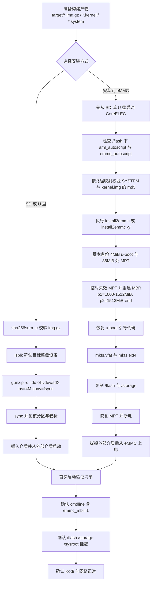
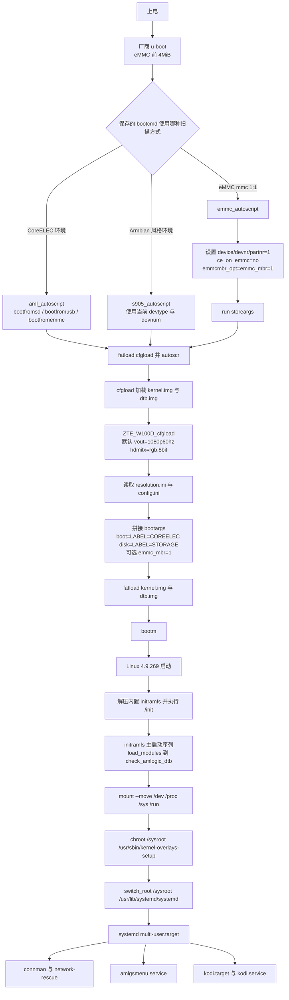

# 刷机教程

本文面向需要在 **ZTE W100D（Amlogic S905X2，2G DDR4，eMMC）** 上安装本仓库构建的 CoreELEC 21.2-Omega（Amlogic-ng，内核 4.9.269）的工程师。内容基于仓库中的真实脚本与构建参数，涵盖 SD/U 盘启动盘制作、eMMC 安装、首次启动验证与常见故障排查。

相关文档：

- [项目架构总览](architecture-overview.md)
- [项目流程模型图](workflow-diagrams.md)

---

## 1. 适用范围与前置条件

### 1.1 适用硬件

| 项目 | 要求 |
| --- | --- |
| 主机 | ZTE W100D（Amlogic S905X2 / G12A），保留厂商 u-boot |
| 内存 | 2GB DDR4（设备树 `g12a_s905x2_2g.dtb`） |
| 存储 | 板载 eMMC；本文档以约 12.8GiB 可用空间的实测设备为例，容量不同则 STORAGE 大小随之变化 |
| 显示 | HDMI 输出，默认 `vout=1080p60hz`、`hdmitx=rgb,8bit` |
| 调试串口 | 板载 UART，参数 `115200 8N1`，内核控制台为 `ttyS0` |
| 外部介质 | SD 卡或 USB 存储设备（用于首次启动与安装到 eMMC） |

> 注意：本项目 **不替换厂商 u-boot**。eMMC 前 4MiB 是厂商 u-boot 与 bootloader 环境变量保留区，任何刷写操作都不得覆盖。

### 1.2 线材与工具

| 类别 | 说明 |
| --- | --- |
| 存储介质 | SD 卡（推荐 Class 10 以上）或 USB 2.0/3.0 U 盘，容量不小于 1GB |
| 读卡器 | USB SD 读卡器，Linux 下通常识别为 `/dev/sdX` 或 `/dev/mmcblk0` |
| 串口线 | 3.3V USB-TTL（GND、TX、RX），用于观察 u-boot 与 initramfs 日志 |
| 电源 | 原装 12V 电源，刷机过程中禁止断电 |
| 主机系统 | Linux（推荐），需要 `dd`、`gzip`、`sha256sum`、`lsblk`、`mount`、`md5sum` |
| 可选工具 | balenaEtcher（Windows/macOS/Linux 图形化写盘）、`screen`/`minicom`/`picocom`（串口） |

### 1.3 网络条件

- 有线网络：板载 MAC 或 USB 网卡均可。项目预加载 `r8152`、`cdc_ether`、`cdc_eem`、`cdc_ncm`、`asix`、`ax88179_178a`、`smsc75xx`、`smsc95xx`、`lan78xx`、`rndis_host` 等驱动。
- DHCP：系统默认由 connman 发起 DHCP。若链路没有 DHCP 服务，可启用 `network-rescue` 的静态兜底。
- Windows ICS：`192.168.137.1` 是 Windows 互联网连接共享的默认网关地址。**能 ping 通该地址不代表链路上有 DHCP 服务器**；实测中该地址可 ping 通但 DHCP 探测收不到 OFFER，属于对端未提供 DHCP 服务，不是驱动或 connman 故障。

### 1.4 构建产物前置

刷机前需要已有构建产物（构建方法见 [项目架构总览](architecture-overview.md) 的构建系统章节）：

```bash
cd /path/to/CoreELEC_FPV
./build_ng_w100d.sh
```

构建完成后，`target/` 下至少应有：

| 文件 | 典型大小（实测） | 用途 |
| --- | --- | --- |
| `CoreELEC-Amlogic-ng.arm-21.2-Omega_devel_<时间戳>-ZTE_W100D.img.gz` | 约 269MB | 整盘镜像，写 SD/U 盘 |
| `...img.gz.sha256` | 139 字节 | 镜像校验 |
| `CoreELEC-Amlogic-ng.arm-21.2-Omega_devel_<时间戳>.kernel` | 17582080 字节（约 16.8MiB） | 内核 + initramfs，供升级或手工替换 |
| `CoreELEC-Amlogic-ng.arm-21.2-Omega_devel_<时间戳>.system` | 约 277MB（约 264.7MiB） | squashfs 根文件系统 |
| `...tar` | 约 301MB | 发布压缩包，内含 `target/SYSTEM`、`target/KERNEL` 与 md5 |

> 本仓库当前 `SQUASHFS_COMPRESSION` 为 `lzo`（`projects/Amlogic-ce/devices/Amlogic-ng/options`），`SQUASHFS_COMPRESSION_OPTION` 由 `scripts/image` 推导为 `-Xcompression-level 9 -b 524288`，即 lzo level 9、512KiB 块。可用 `file <xxx>.system` 复核，输出应类似 `Squashfs filesystem ... lzo compressed ... blocksize: 524288 bytes`。

---

## 2. 分区布局

### 2.1 两种布局的区别

本项目存在两套分区布局，**不要混淆**：

1. **SD/U 盘整盘镜像布局**：由 `scripts/mkimage` 生成，p1 从 **4MiB（8192 扇区）** 开始，p2 只有 32MiB，首次启动时通过 `/storage/.please_resize_me` 自动扩容到介质末尾。
2. **eMMC 安装布局**：由 `install2emmc` 生成，p1 从 **1000MiB** 开始，以避开厂商 u-boot 环境、DTB 等保留区域；p2 直接使用 eMMC 剩余全部空间。

两套布局的卷标一致：`COREELEC`（vfat，挂载 `/flash`）与 `STORAGE`（ext4，挂载 `/storage`）。

### 2.2 SD/U 盘镜像布局

| 分区 | 起始偏移 | 大小 | 文件系统 | 卷标 | 挂载点 |
| --- | --- | --- | --- | --- | --- |
| 保留区 | 0 | 4MiB | 无 | 无 | 无（MBR 引导代码区域） |
| p1 | 4MiB（8192 扇区） | 512MiB | vfat（FAT32） | `COREELEC` | `/flash` |
| p2 | 516MiB | 32MiB | ext4 | `STORAGE` | `/storage`（首次启动后扩容） |

镜像总大小 = 4MiB 对齐填充 + 512MiB + 32MiB = 548MiB。实测 `...img` 为 574619648 字节。

### 2.3 eMMC 安装布局（install2emmc）

| 区域 | 起始偏移 | 大小 | 说明 |
| --- | --- | --- | --- |
| 厂商 u-boot / 环境 | 0 | 4MiB | 安装前备份、分区后原样写回，禁止覆盖 |
| Amlogic MPT | 36MiB（`0x2400000`，扇区 73728） | 约 1MiB 区域 | 安装期间临时清除 4 字节签名，结束时恢复；`emmc_mbr=1` 让内核忽略它 |
| p1 | 1000MiB | 512MiB | vfat，卷标 `COREELEC`，挂载 `/flash` |
| p2 | 1513MiB | 到 eMMC 末尾 | ext4，卷标 `STORAGE`，挂载 `/storage` |

`install2emmc` 计算方式（见脚本顶部）：

```text
UNPARTITIONED_MB=1000
SYSTEM_SIZE_MB=@SYSTEM_SIZE@   # 构建时替换为 512
BOOT_START_MB=1000
BOOT_END_MB=1000+512=1512
STORAGE_START_MB=1512+1=1513
```

### 2.4 MPT 与 MBR 的冲突

- Amlogic MPT 位于 eMMC 偏移 36MiB，会干扰标准 MBR 解析。
- 内核补丁 `projects/Amlogic-ce/devices/Amlogic-ng/patches/linux/linux-11-add-emmc-mbr-boot-option.patch` 在检测到内核命令行含 `emmc_mbr=1` 时：
  - 跳过 `block/partition-generic.c` 中的 MPT 校验；
  - 跳过 `drivers/amlogic/mmc/emmc_partitions.c` 中用 MPT 覆盖标准 MBR 分区的逻辑。
- 不加该参数时，内核只认 MPT，看不到 `p1/p2`，表现为 `mount_common: Could not mount LABEL=COREELEC`，屏幕长时间黑屏（等待超过 10 分钟仍无显示）。
- eMMC 启动时的 cmdline 形如：

```text
BOOT_IMAGE=kernel.img boot=LABEL=COREELEC disk=LABEL=STORAGE emmc_mbr=1 quiet console=ttyS0,115200 no_console_suspend vout=1080p60hz,en logo=osd0,loaded,0x3f800000 frac_rate_policy=0 native_4k_gui=0 hdmitx=rgb,8bit hdr_policy=1
```

---

## 3. 方式一：制作 SD/U 盘启动盘

### 3.1 校验镜像

```bash
cd /path/to/CoreELEC_FPV/target
sha256sum -c CoreELEC-Amlogic-ng.arm-21.2-Omega_devel_<时间戳>-ZTE_W100D.img.gz.sha256
```

输出应为：

```text
CoreELEC-Amlogic-ng.arm-21.2-Omega_devel_<时间戳>-ZTE_W100D.img.gz: OK
```

### 3.2 确认目标设备

**写盘前必须确认设备名，避免写错硬盘。**

```bash
lsblk -o NAME,SIZE,TYPE,FSTYPE,LABEL,MOUNTPOINT
```

SD 读卡器常见为 `/dev/sdb`、`/dev/sdc`，部分机器为 `/dev/mmcblk0`。以下命令假设目标是 `/dev/sdX`，请替换为实际设备。

### 3.3 写盘（dd）

方式 A：直接写 gzip 压缩流，无需先解压。

```bash
gunzip -c CoreELEC-Amlogic-ng.arm-21.2-Omega_devel_<时间戳>-ZTE_W100D.img.gz \
  | sudo dd of=/dev/sdX bs=4M conv=fsync status=progress
sync
```

方式 B：先解压再写。

```bash
gunzip -k CoreELEC-Amlogic-ng.arm-21.2-Omega_devel_<时间戳>-ZTE_W100D.img.gz
sudo dd if=CoreELEC-Amlogic-ng.arm-21.2-Omega_devel_<时间戳>-ZTE_W100D.img \
        of=/dev/sdX bs=4M conv=fsync status=progress
sync
```

> 注意：`of=` 必须是整盘设备（`/dev/sdX`），不能写分区（`/dev/sdX1`）。写盘会清空介质上所有数据。

### 3.4 写盘（balenaEtcher）

1. 选择 `...-ZTE_W100D.img.gz`（Etcher 可直接识别 `.img.gz`）。
2. 选择目标 SD/USB 设备。
3. 点击 Flash，等待校验完成。
4. 若 Etcher 提示镜像大于介质，说明介质容量不足 548MiB 或读卡器异常。

### 3.5 写盘后校验

```bash
# 确认分区表与卷标
lsblk -o NAME,SIZE,FSTYPE,LABEL,MOUNTPOINT /dev/sdX

# 期望输出包含：
# sdX1  512M  vfat  COREELEC
# sdX2   32M  ext4  STORAGE
```

如需进一步核对镜像内容，可挂载 p1 查看启动文件：

```bash
sudo mkdir -p /mnt/ceflash
sudo mount -o ro /dev/sdX1 /mnt/ceflash
ls -la /mnt/ceflash
sudo umount /mnt/ceflash
```

`/flash` 根目录应至少包含：

| 文件 | 作用 |
| --- | --- |
| `aml_autoscript` | CoreELEC 标准 u-boot 启动脚本（扫描 SD/USB/eMMC） |
| `s905_autoscript` | 兼容只扫描 `s905_autoscript` 的厂商 u-boot |
| `emmc_autoscript` | eMMC 启动入口，设置 `emmc_mbr=1` |
| `cfgload` | 实际加载 kernel/dtb 的脚本（本设备为 `ZTE_W100D_cfgload` 编译产物） |
| `kernel.img` | 内核 + initramfs（Android bootimg 格式） |
| `dtb.img` | 设备树（`ZTE_W100D_dtb.img`，来自 `g12a_s905x2_2g.dtb`） |
| `SYSTEM` | squashfs 根文件系统 |
| `SYSTEM.md5`、`kernel.img.md5` | md5 清单（注意文件内路径为 `target/SYSTEM`、`target/KERNEL`） |
| `config.ini` | u-boot 环境变量覆盖（vout、wol、cec 等） |
| `device_trees/` | 可选设备树集合 |

### 3.6 从 SD/U 盘启动

1. 断电，插入写好的 SD 卡或 U 盘。
2. 接好 HDMI 与串口（`115200 8N1`）。
3. 上电。厂商 u-boot 的 `bootcmd` 会依次尝试 SD、USB、eMMC。
4. 串口应看到类似输出：

```text
Using device mmc, number 0, partition 1, CoreELEC on eMMC: no
...
mmcblk0: p1 p2
```

> 本设备 `cfgload` 故意移除了 `console=tty0`，内核 printk 只输出到串口，避免内核日志覆盖 FPV OSD。因此 **HDMI 上看不到内核日志是正常现象**，排障请以串口为准。

---

## 4. 方式二：安装到 eMMC

### 4.1 为什么不用 ceemmc

`ceemmc` 是 CoreELEC 提供的闭源预编译二进制（见 `projects/Amlogic-ce/packages/tools/ceemmc/package.mk`，只下载二进制、无源码），按 Amlogic 原厂 MPT 分区布局设计。本设备若曾安装 Armbian 或已被重新分区，`ceemmc` 在重建分区表阶段会失败并回滚。因此本项目提供 `install2emmc`，按 Armbian `install-aml.sh` 的思路处理厂商 u-boot 保留区、MPT 与标准 MBR。

### 4.2 前提

- 设备已从 **SD/U 盘** 启动 CoreELEC（不能从 eMMC 自身运行安装脚本；脚本会检测到 eMMC 是启动盘并报错）。
- `/flash` 已挂载，且存在 `aml_autoscript` 与 `emmc_autoscript`。
- eMMC 容量大于 1513MiB，且当前 `/storage` 已用空间不超过目标 STORAGE 分区的 95%。

### 4.3 安装前检查

```bash
# 确认启动介质不是 eMMC
mount | grep ' /flash '
findmnt -no SOURCE /flash

# 确认启动脚本存在
ls -l /flash/aml_autoscript /flash/emmc_autoscript /flash/cfgload

# 确认 kernel/SYSTEM 完整（可选，见 4.4）
ls -l /flash/kernel.img /flash/SYSTEM
```

### 4.4 校验启动文件 md5

镜像内的 md5 清单沿用了发布目录结构，内容分别是 `target/SYSTEM` 与 `target/KERNEL`，直接在 `/flash` 执行 `md5sum -c` 会因路径不存在而失败。需要先做路径映射：

```bash
cd /flash

# SYSTEM
sed 's#target/SYSTEM#SYSTEM#' SYSTEM.md5 | md5sum -c -

# 内核（镜像内文件名为 kernel.img，清单里写作 target/KERNEL）
sed 's#target/KERNEL#kernel.img#' kernel.img.md5 | md5sum -c -
```

两条命令都应输出 `OK`。

> `install2emmc` 本身 **不做 md5 校验**，它只复制文件。上述校验需要在安装前手工执行，或安装后在目标分区复核。

### 4.5 执行安装

```bash
install2emmc
```

脚本会打印目标布局并要求确认：

```text
Installing CoreELEC to /dev/mmcblk1

  boot    : 1000MiB - 1512MiB, vfat, label COREELEC
  storage : 1513MiB - end, ext4, label STORAGE (<计算值>MB)
  /storage: <已用>MB will be copied

WARNING: ALL DATA ON /dev/mmcblk1 WILL BE ERASED!

Continue (y/N)?
```

非交互场景可直接加 `-y`：

```bash
install2emmc -y
```

### 4.6 install2emmc 内部步骤

脚本路径：`projects/Amlogic-ce/devices/Amlogic-ng/filesystem/usr/bin/install2emmc`。

1. **定位启动介质**：读取 `/proc/mounts` 中 `/flash` 的设备，得到 `BOOT_DEV` 与 `BOOT_DISK`。
2. **定位 eMMC**：遍历 `/sys/block/mmcblk*`，跳过 `*boot*`、`*rpmb*`，要求 `device/type` 为 `MMC`，且不是当前启动盘。找不到则报 `no eMMC found`。
3. **布局检查**：要求 `/flash/aml_autoscript` 存在；`emmc_autoscript` 优先取 `/flash`，否则取 `/usr/share/bootloader/emmc_autoscript`。
4. **容量检查**：`EMMC_MB = /sys/block/<dev>/size / 2048`，必须大于 1513MiB；`/storage` 已用空间不得超过目标 STORAGE 的 95%。
5. **卸载 eMMC 上已有分区**：对匹配 `<emmc>p?[0-9]+` 的挂载点执行 `umount -f`，失败则 `umount -l`。
6. **备份 u-boot**：`dd if=<emmc> of=/tmp/install2emmc.uboot.img bs=1M count=4`。
7. **备份 MPT**：`dd if=<emmc> of=/tmp/install2emmc.mpt.img bs=512 skip=73728 count=8`（73728 扇区 = 36MiB）。
8. **临时使 MPT 失效**：若备份前 3 字节为 `MPT`，向 eMMC 偏移 37748736 写入 4 个零字节，避免分区/复制期间内核或工具误读 MPT。
9. **重建 MBR**：`parted -s <emmc> mklabel msdos`，然后创建 p1（1000MiB–1512MiB，fat32）与 p2（1513MiB–100%，ext4）。
10. **写回 u-boot**：先用 `bs=1 count=442` 写回 MBR 引导代码，再用 `bs=512 skip=1 seek=1` 写回其余部分。这样保留新分区表，同时恢复厂商 u-boot。
11. **刷新分区表**：`partprobe` + `udevadm settle`，最多等待 20 秒直到 `<emmc>p1`、`<emmc>p2` 出现。
12. **创建文件系统**：`mkfs.vfat -n COREELEC <emmc>p1`；`mkfs.ext4 -F -q -L STORAGE -m 0 <emmc>p2`。
13. **复制 boot**：挂载 p1 到 `/tmp/install2emmc.boot`，`cp -a /flash/. <mnt>/`，再用镜像内的 `emmc_autoscript` 覆盖目标上的同名文件。
14. **复制 storage**：`systemctl stop kodi`，挂载 p2，`rsync -a --exclude=.please_resize_me /storage/. <mnt>/`。
15. **恢复 MPT**：把备份的 4 字节签名写回 36MiB 偏移。恢复后 **不再执行 partprobe**，以免运行中的安装器丢失 MBR 视图。
16. **清理并提示断电**：删除临时备份，输出 `Installation complete.`。

### 4.7 安装后首次从 eMMC 启动

1. `poweroff`。
2. 拔掉 SD 卡/U 盘。
3. 重新上电。厂商 u-boot 保存的环境会执行 `start_emmc_autoscript`，从 `mmc 1:1` 加载 `emmc_autoscript`。
4. `emmc_autoscript` 设置：
   - `device=${devtype}`、`devnr=${devnum}`、`partnr=1`
   - `ce_on_emmc=no`（因为 install2emmc 使用与 SD 相同的 `COREELEC`/`STORAGE` 卷标）
   - `emmcmbr_opt=emmc_mbr=1`
   - `run storeargs` 初始化显示地址与 bootargs 基址
   - 加载并执行 `cfgload`
5. `cfgload`（由 `ZTE_W100D_cfgload.src` 编译）加载 `config.ini`、`kernel.img`、`dtb.img` 并 `bootm`。

---

## 5. 刷机流程图



---

## 6. 启动链流程图



---

## 7. 首次启动验证清单

以下命令在设备本机（SSH 或串口）执行。

### 7.1 内核命令行

```bash
cat /proc/cmdline
```

eMMC 启动应包含：

```text
boot=LABEL=COREELEC disk=LABEL=STORAGE emmc_mbr=1
```

SD/U 盘启动不包含 `emmc_mbr=1`（也不需要）。同时应看到 `console=ttyS0,115200` 与 `vout=1080p60hz`。

### 7.2 分区与 MBR 生效

```bash
dmesg | grep -E "mmcblk|keep standard MBR|MPT"
```

期望看到类似：

```text
mmcblk0: p1 p2
... keep standard MBR partitions
```

若看到 MPT 相关分区覆盖日志（22 个 Amlogic 分区），说明 `emmc_mbr=1` 没有传进内核，回到故障排查表。

```bash
lsblk -o NAME,SIZE,FSTYPE,LABEL,MOUNTPOINT
```

eMMC 启动期望：

| 设备 | 大小 | 文件系统 | 卷标 | 挂载点 |
| --- | --- | --- | --- | --- |
| `mmcblk0p1` | 512M | vfat | `COREELEC` | `/flash` |
| `mmcblk0p2` | 剩余 | ext4 | `STORAGE` | `/storage` |

### 7.3 挂载状态

```bash
mount | grep -E ' /flash | /storage | /sysroot '
df -h /flash /storage
```

- `/flash` 应为 `ro`（只读），`/storage` 应为 `rw`。
- `/sysroot` 是 `/flash/SYSTEM` 的 loop 只读挂载。

### 7.4 系统与服务

```bash
cat /etc/os-release
systemctl --failed --no-pager
systemctl status kodi --no-pager
systemctl status amlgsmenu --no-pager
systemctl status amldigitalfpv --no-pager
systemctl status network-rescue --no-pager
```

- `kodi.service` 应为 `active (running)`。
- `amlgsmenu.service` 与 `amldigitalfpv.service` 允许在无 FPV 硬件时反复重启，但日志中应能看出启动尝试。

### 7.5 Kodi

```bash
tail -n 80 /storage/.kodi/temp/kodi.log
```

确认无 `ERROR: Unable to create application`、GL/EGL 初始化失败等致命错误。

### 7.6 网络

```bash
ip -4 addr show
ip route show
cat /run/connman/resolv.conf 2>/dev/null
ping -c 3 192.168.137.1
```

- 有线接口应拿到非 `169.254.x.x` 的地址，或已应用静态兜底地址。
- 默认路由应存在 `default via ...`。
- 若只有 `169.254.x.x`，查看 `network-rescue` 日志：

```bash
dmesg | grep network-rescue
journalctl -u network-rescue -n 100 --no-pager
```

### 7.7 串口日志

```bash
dmesg | tail -n 100
```

initramfs 阶段的日志在启动后会被移动到 `/storage/init.log`（若生成）；上一次异常启动的日志在 `/storage/init-previous.log`。

---

## 8. 常见故障排查

| 现象 | 原因 | 处理 |
| --- | --- | --- |
| 上电后 HDMI 全黑，串口无任何输出 | 未从写好的介质启动；卡未插好；镜像写坏；供电不足 | 重新执行 `sha256sum -c` 与写盘；确认 `lsblk` 看到 `COREELEC`；换 USB 口/读卡器；用串口确认 u-boot 是否运行 |
| 串口停在 u-boot，反复扫描但不引导 | u-boot 环境未配置为扫描该介质；`aml_autoscript`/`s905_autoscript` 缺失 | 确认 `/flash` 下有 `aml_autoscript` 与 `s905_autoscript`；尝试另一个 USB 口；必要时从串口手动 `fatload mmc 0:1 ... cfgload` |
| 串口出现 `mount_common: Could not mount LABEL=COREELEC`，随后长时间黑屏 | 内核把 MPT 当成分区表，删除了标准 MBR 的 p1/p2；缺少 `emmc_mbr=1` | eMMC 启动时确认 `emmc_autoscript` 内含 `emmcmbr_opt=emmc_mbr=1` 且 `cfgload` 把它拼进 `initargs`；用 `dmesg` 查 `keep standard MBR partitions`；重新安装或替换 eMMC 上的 `emmc_autoscript`/`cfgload` |
| 串口显示 `MPT` 相关 22 个分区，`lsblk` 没有 `COREELEC`/`STORAGE` | 同上，MPT 生效 | 同上；临时清除 36MiB 处 `MPT` 签名只对本次启动有效，厂商 u-boot 会从 DTB 恢复，不能作为最终修复 |
| 启动卡在 init，出现 `*** Error in <step> ... ***` 与调试 shell | 某一步 initramfs 失败，例如 `mount_flash`、`mount_sysroot`、`prepare_sysroot` | 记录报错步骤；检查 `/flash` 上 `SYSTEM`/`kernel.img` 是否完整；用串口执行 `mount`、`blkid`、`fsck.fat` 排查；参见 [故障恢复流程](workflow-diagrams.md#6-故障恢复流程) |
| `cp: write error: No space left on device`，或 SYSTEM 被截断 | 在运行中的系统里删除 `/flash/SYSTEM` 不会立即释放 FAT 簇，旧文件仍被 loop 设备打开；继续 `cp` 会写满并截断新文件 | 不要在线替换 SYSTEM。应在启动早期的 `/flash/post-flash.sh` 中、或在另一台机器/外部介质上操作；必要时先 `fsck.fat -a` 回收孤儿簇，再重新复制 |
| `SYSTEM.md5` 校验失败 | md5 清单内路径为 `target/SYSTEM`，直接在 `/flash` 校验找不到文件；或文件确实损坏 | 使用本文 4.4 的 `sed` 路径映射；损坏则从 `...tar` 或镜像重新复制 `SYSTEM` |
| DHCP 一直拿不到地址，接口只有 `169.254.x.x` | 链路上没有 DHCP 服务（例如 Windows ICS 只提供 `192.168.137.1` 但不发 OFFER），或 connman 自动连接卡住 | 先 `dmesg | grep network-rescue` 确认 udhcpc 探测结果；若显示 `DHCP server not answering`，在 `/storage/.config/network-rescue.conf` 设置 `STATIC_IP` 与 `STATIC_GW`；参见 [网络初始化流程](workflow-diagrams.md#4-网络初始化流程) |
| `192.168.137.1` 能 ping 通，但设备仍无 IP | 对端是 Windows ICS 网关，未必运行 DHCP 服务；能 ping 只说明链路与 ARP 正常 | 配置静态地址，例如 `STATIC_IP=192.168.137.2/24`、`STATIC_GW=192.168.137.1`，然后重启 `network-rescue` |
| SSH 连不上，但串口本地登录正常 | connman 遗留无网关路由，默认路由缺失；或静态地址被 connman 清除 | 串口执行 `ip route show`，确认有 `default via ...`；`network-rescue` 的 `drop_stray_routes` 会删除无 `via` 且无 `src` 的路由；**不要**执行 `ip route flush dev <if>`，那会删除内核直连路由导致 SSH 断开 |
| 启动后完全没有网络接口 | USB 网卡驱动未加载，或网卡未被识别 | `dmesg | grep -i usb`、`ip link`；确认 `/usr/lib/modules-load.d/usbnet.conf` 存在；必要时手工 `modprobe r8152` / `modprobe cdc_ether`；内置 MAC 检查 `ethtool` 与载波状态 |
| 有线网卡有载波但 network-rescue 一直等待 | 等待逻辑最多 36 次、每次 5 秒寻找有线接口，之后还要等 15 秒给 connman | 正常现象；若超过 3 分钟仍无动作，检查 `/sys/class/net/<if>/carrier` 是否为 1，以及接口是否被识别为无线（存在 `wireless` 目录会被跳过） |
| Kodi 不启动，屏幕黑或停在 CoreELEC splash | Kodi 崩溃；GPU/HDMI 初始化失败；`AMLgsMenu` 占用了显示 | `systemctl status kodi`、查看 `/storage/.kodi/temp/kodi.log`；临时 `systemctl stop amlgsmenu amldigitalfpv` 后重启 Kodi；检查 `dmesg | grep -i amhdmitx` |
| 画面颜色异常或图像被挤到屏幕上半部 | HDMI sink 对 YUV444 支持不佳 | `ZTE_W100D_cfgload` 默认 `hdmitx=rgb,8bit`；确认 `config.ini` 没有覆盖为 `yuv444` |
| eMMC 安装完成，断电重启仍进入旧系统或 SD 系统 | 外部介质未拔；u-boot 启动顺序优先 SD/USB | 拔掉 SD/U 盘；确认串口显示从 `mmc 1:1` 加载 `emmc_autoscript` |
| eMMC 安装脚本报 `this boot media uses a different bootloader layout` | `/flash` 下缺少 `aml_autoscript`，说明当前不是本项目镜像 | 使用本项目构建的 `ZTE_W100D.img.gz` 启动后再安装 |
| 安装脚本报 `no eMMC found (or CoreELEC is already running from it)` | 已从 eMMC 启动，或 eMMC 未被内核枚举 | 必须从 SD/U 盘启动；`lsblk` 确认能看到 `mmcblk1` |
| 安装脚本报 `eMMC is too small` | eMMC 容量小于 1513MiB + 必要空间 | 更换设备或调整布局（需改脚本常量，不建议） |
| 升级后无法启动，`/storage/.update/.tmp` 残留 | 上次升级中断，init 检测到 `.tmp` 后执行恢复流程 | 正常应自动清理并继续启动；若仍失败，删除 `/storage/.update/.tmp` 后重试，或按故障恢复流程处理 |
| 没有 `wlan0`，板载 WiFi 不可用 | 4.9.269 内核无 MT7663S 驱动，且镜像未包含对应固件 | 已知限制，非故障。详见 8.1 |

### 8.1 板载 WiFi 不可用（已知限制）

W100D 板载无线芯片为 **MediaTek MT7661LSN（MT7663 SDIO combo）**，当前镜像没有可用驱动，`wlan0` 不会出现。已确认的事实：

- **SDIO 控制器正常**：`/sys/bus/sdio/devices/` 下可见 `sdio:0001:1`（`0x037a:0x7603`，WiFi 功能）与 `sdio:0001:2`（`0x037a:0x7663`，蓝牙功能），说明 `sd_emmc_b2`（`0xffe05000`）已启用、上电与时钟可用。
- **WiFi 功能无驱动绑定**：`sdio:0001:1/driver` 为空。仓库内置的 `wlan_mt76x8_sdio.ko`（`mt7668-wifi-bt` 包）SDIO ID 表只有 `0x6602` 与 `0x7608`，不匹配 `0x7603`；4.9.269 内核也没有 `mt76`/`mt7663s`。
- **固件缺失**：`/lib/firmware/mediatek/` 下没有 `mt7663_n9_v3.bin`、`mt7663pr2h.bin`。固件源码树中存在这两个文件，但 `packages/linux-firmware/kernel-firmware/firmwares/any.dat` 与 `projects/Amlogic/config/kernel-firmware.dat` 的 mediatek 清单未选中，因此未装入镜像。
- **蓝牙半可用**：`btmtk_sdio` 已绑定 `0x037a:0x7663`，但 `hci0` 为 `DOWN`、BD 地址全 0，同样缺 `mt7663_patch_e1_hdr.bin`/`mt7663_patch_e2_hdr.bin` 补丁固件。

为什么不能直接复用 Armbian 的驱动：Armbian 方案是主线 `mt7663s`（`drivers/net/wireless/mediatek/mt76/mt7663s`），属于 `mt76` 框架，5.12 才合入主线，依赖 `mt76` core、`mt7615-common`、`mt76-sdio`，还需要 `meson-gx-mmc` 与 `mmc/core/sdio.c` 的板级补丁。这些接口在 4.9 上不存在，无法回移。MediaTek 对 MT7663S 的 Turnkey WiFi/BT 驱动为 NDA 闭源。

排查命令：

```bash
ls -l /sys/bus/sdio/devices/
cat /sys/bus/sdio/devices/sdio:0001:1/{vendor,device} /sys/bus/sdio/devices/sdio:0001:2/{vendor,device}
lsmod | grep -E "mt76|btmtk"
modinfo wlan_mt76x8_sdio | grep alias
ls /lib/firmware/mediatek/ | grep -i 7663
hciconfig -a
```

**当前方案**：板载 WiFi 保持不可用，联网使用 USB 有线网卡（见 7.6 与 9.4）。若要启用板载 WiFi，需要引入 4.9 可用的厂商 MT7663S SDIO 驱动包，并补齐上述固件与板级 SDIO 时序（GPIOX_6 pwrseq、32.768kHz 外部时钟、固定 1.8V、上电延时、SDR104）。

---

## 9. 快速命令附录

### 9.1 串口连接

```bash
sudo picocom -b 115200 /dev/ttyUSB0
# 或
sudo screen /dev/ttyUSB0 115200
```

退出 `picocom` 使用 `Ctrl-A` 再按 `Ctrl-X`。

### 9.2 手工挂载/检查 flash

```bash
sudo mkdir -p /mnt/ceflash
sudo mount -o ro /dev/sdX1 /mnt/ceflash
sudo fsck.fat -n /dev/sdX1        # 只检查
sudo fsck.fat -a /dev/sdX1        # 自动修复
sudo umount /mnt/ceflash
```

### 9.3 复制 SYSTEM 到 eMMC（从外部 Linux 主机）

仅在设备断电、eMMC 通过读卡器/转接板连接到主机，或从另一启动介质操作时执行：

```bash
sudo mount /dev/sdX1 /mnt/ceflash
sudo cp /path/to/CoreELEC-...-ZTE_W100D.system /mnt/ceflash/SYSTEM
sync
sudo umount /mnt/ceflash
```

### 9.4 静态网络兜底配置

```bash
mkdir -p /storage/.config
cat > /storage/.config/network-rescue.conf <<'EOF'
STATIC_IP=192.168.137.2/24
STATIC_GW=192.168.137.1
ATTEMPTS=6
EOF
systemctl restart network-rescue
```

`STATIC_IP` 未设置时静态兜底关闭；`ATTEMPTS` 默认 6。

### 9.5 查看 initramfs 日志

```bash
ls -l /storage/init.log /storage/init-previous.log 2>/dev/null
cat /storage/init-previous.log 2>/dev/null
```
