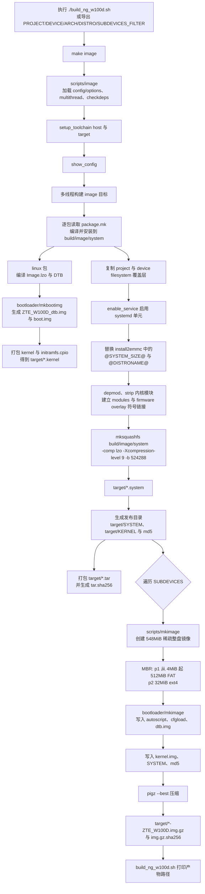
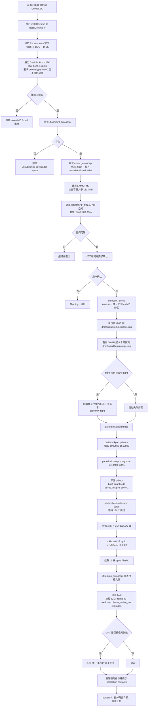
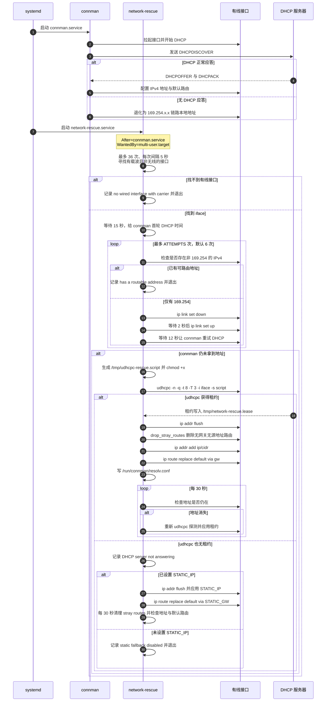
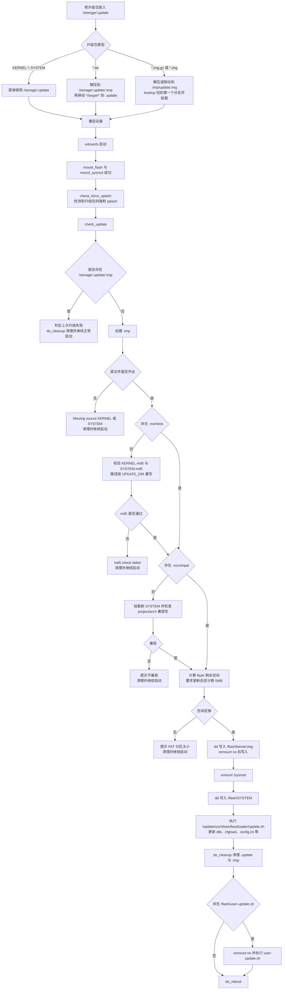
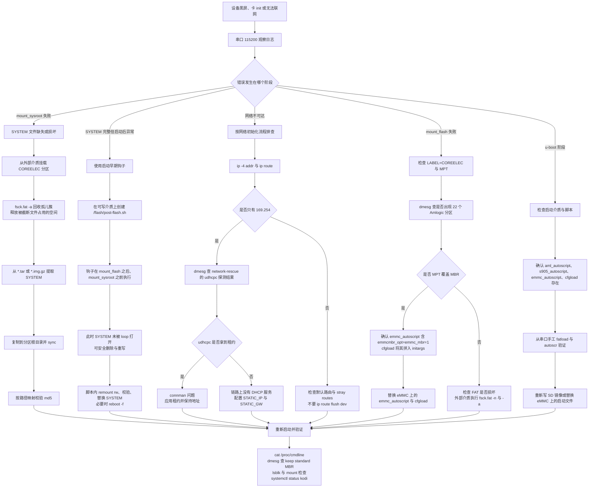

# 项目流程模型图

本文用 Mermaid 图描述本项目的六条核心流程：构建、启动、eMMC 安装、网络初始化、升级、故障恢复。每张图后附实现细节与真实文件路径。

相关文档：

- [刷机教程](flashing-guide.md)
- [项目架构总览](architecture-overview.md)

---

## 1. 构建流水线

### 1.1 流程图



### 1.2 说明

- 入口脚本：`build_ng_w100d.sh`。它导出 `PROJECT=Amlogic-ce`、`DEVICE=Amlogic-ng`、`ARCH=arm`、`DISTRO=CoreELEC`、`SUBDEVICES_FILTER=ZTE_W100D`，然后执行 `make image`。
- 增量保护：若 `build.CoreELEC-Amlogic-ng.arm-21/.stamps/linux/build_target` 存在，但 `build/.../arch/arm64/boot/ZTE_W100D_dtb.img` 缺失，脚本删除该 stamp，强制重新编译内核，避免镜像缺 `dtb.img`。
- 配置合并：`config/options` 依序加载发行版、项目、设备 options；`SUBDEVICES_FILTER` 在 `projects/Amlogic-ce/devices/Amlogic-ng/options` 中被读取，直接替换 `SUBDEVICES` 列表。
- 内核打包：`projects/Amlogic-ce/devices/Amlogic-ng/bootloader/mkbootimg` 遍历 `SUBDEVICES`，对 `ZTE_W100D` 从 `bootloader/dtb.conf` 找到 `g12a_s905x2_2g.dtb`，复制为 `ZTE_W100D_dtb.dtb`，再生成 `ZTE_W100D_dtb.img`；最后用 `mkbootimg --kernel Image.lzo --ramdisk initramfs.cpio` 生成 `boot.img`，构建系统将其复制为 `target/*.kernel`。
- squashfs：`scripts/image` 在 `SQUASHFS_COMPRESSION_OPTION` 为空时按压缩算法推导；本设备 `SQUASHFS_COMPRESSION="lzo"`，因此实际参数是 `-Xcompression-level 9 -b 524288`。可用 `file target/*.system` 验证。
- 整盘镜像：`scripts/mkimage` 根据 `SYSTEM_SIZE=512`、`SYSTEM_PART_START=8192`、`STORAGE_SIZE=32` 计算镜像大小 548MiB；p1 起始 4MiB，p2 起始 516MiB。
- 启动文件：`projects/Amlogic-ce/devices/Amlogic-ng/bootloader/mkimage` 把 `*autoscript` 复制到 FAT 根目录，把 `${SUBDEVICE}_cfgload` 复制为 `/cfgload`，并写入 `${SUBDEVICE}_dtb.img` 为 `/dtb.img`。
- 发布包：`scripts/image` 在 `target/<IMAGE_NAME>/target/` 下生成 `SYSTEM`、`KERNEL` 及 md5，再打包为 `target/*.tar`。md5 内容中的路径为 `target/SYSTEM`、`target/KERNEL`。

---

## 2. 启动流程

### 2.1 流程图

```mermaid
flowchart TD
    A["上电"] --> B["厂商 u-boot<br/>eMMC 前 4MiB"]
    B --> C{"保存的启动环境选择介质"}

    C -->|"CoreELEC 环境"| D["aml_autoscript<br/>bootfromsd / bootfromusb / bootfromemmc"]
    C -->|"Armbian 风格环境<br/>SD mmc 0 / USB usb 0"| E["s905_autoscript<br/>使用当前 devtype 与 devnum"]
    C -->|"Armbian 风格环境<br/>eMMC mmc 1:1"| F["emmc_autoscript"]

    D --> G["fatload cfgload 并 autoscr"]
    E --> G
    F --> H["设置 device=devtype<br/>devnr=devnum<br/>partnr=1<br/>ce_on_emmc=no<br/>emmcmbr_opt=emmc_mbr=1"]
    H --> I["run storeargs"]
    I --> G

    G --> J["ZTE_W100D_cfgload"]
    J --> K["设置 quiet、vout=1080p60hz、frac_rate_policy=0<br/>hdmitx=rgb,8bit（可由 config.ini 覆盖）"]
    K --> L["fatload resolution.ini 并 env import"]
    L --> M["fatload config.ini 并 env import"]
    M --> N["拼接 rootopt、consoleopt、displayopt、initargs"]
    N --> O["bootargs 含 boot=LABEL=COREELEC<br/>disk=LABEL=STORAGE<br/>eMMC 时含 emmc_mbr=1"]
    O --> P["fatload kernel.img 到 loadaddr"]
    P --> Q["fatload dtb.img 到 dtb_mem_addr"]
    Q --> R["bootm start / loados / prep / go"]

    R --> S["Linux 4.9.269<br/>解压内置 initramfs"]
    S --> T["执行 /init<br/>挂载 devtmpfs、proc、sysfs、tmpfs /run"]
    T --> U["解析 /proc/cmdline<br/>boot=、disk=、BOOT_IMAGE=、vout= 等"]
    U --> V["platform_init<br/>设置 display mode 与 framebuffer"]

    V --> W["BOOT_STEP: load_modules"]
    W --> X["set_consolefont"]
    X --> Y["check_disks<br/>fsck.fat / e2fsck"]
    Y --> Z["fix_bootlabel"]
    Z --> AA["mount_flash<br/>只读挂载 /flash 并执行 post-flash.sh"]
    AA --> AB["cleanup_flash"]
    AB --> AC["update_bootmenu"]
    AC --> AD["mount_sysroot<br/>ro,loop 挂载 /flash/SYSTEM 并执行 post-sysroot.sh"]
    AD --> AE["mount_storage<br/>rw,noatime 挂载 STORAGE"]
    AE --> AF["check_force_splash"]
    AF --> AG["load_splash"]
    AG --> AH["check_update"]
    AH --> AI["prepare_sysroot<br/>mount --move /flash 与 /storage"]
    AI --> AJ["check_amlogic_dtb"]

    AJ --> AK["mount --move /dev /proc /sys /run 到 /sysroot"]
    AK --> AL["chroot /sysroot /usr/sbin/kernel-overlays-setup"]
    AL --> AM["exec switch_root /sysroot /usr/lib/systemd/systemd"]
    AM --> AN["systemd 启动 multi-user.target 与 kodi.target"]
    AN --> AO["connman、network-rescue、amlgsmenu、amldigitalfpv、kodi"]
```



### 2.2 BOOT_STEP 清单与职责

| 顺序 | BOOT_STEP | 职责 | 失败时的典型表现 |
| --- | --- | --- | --- |
| 1 | `load_modules` | 按 `/etc/modules` 逐个 `insmod`，失败只记录并继续 | 显示/输入设备缺失，但通常不阻塞 |
| 2 | `set_consolefont` | 根据 framebuffer 垂直分辨率设置大字体 | 不影响启动 |
| 3 | `check_disks` | 对 `boot=`、`disk=` 指向的设备运行 `/usr/sbin/fsck -T -M -p -a` | 文件系统损坏时可能进入 `force_fsck` 或重启 |
| 4 | `fix_bootlabel` | 若存在 `/dev/CE_FLASH` 且卷标不是 `CE_FLASH`，用 `fatlabel` 修正 | 仅旧式 eMMC 布局相关 |
| 5 | `mount_flash` | `mount_part "$boot" /flash ro,noatime`，成功后 source `/flash/post-flash.sh` | `mount_common: Could not mount LABEL=COREELEC`，进入调试 shell |
| 6 | `cleanup_flash` | 删除树莓派相关 `pieeprom.bin`、`vl805.bin`、`recovery.bin` 等 | 不影响 Amlogic |
| 7 | `update_bootmenu` | 更新 syslinux/grub 默认项 | 仅 x86/RPi 相关 |
| 8 | `mount_sysroot` | 以 `ro,loop` 挂载 `/flash/SYSTEM` 到 `/sysroot`，source `/flash/post-sysroot.sh` | `Could not mount /flash/SYSTEM` |
| 9 | `mount_storage` | 挂载 `disk=` 到 `/storage`；存在 `/flash/mount-storage.sh` 时优先使用 | `/storage` 未挂载或只读 |
| 10 | `check_force_splash` | 判断是否需要强制显示 splash（升级、恢复、重置等） | 无 |
| 11 | `load_splash` | 选择 `oemsplash-*` 或 `splash-*` 并显示 | 黑屏但系统继续启动 |
| 12 | `check_update` | 检查 `/storage/.update` 并执行升级 | 升级失败会清理并继续启动 |
| 13 | `prepare_sysroot` | `mount --move /flash /sysroot/flash`、`mount --move /storage /sysroot/storage`，检查 systemd | `Could not find systemd!` |
| 14 | `check_amlogic_dtb` | 检查 `/proc/device-tree/coreelec` 与设备树文件是否匹配 | 打印 DTB 过旧警告 |

### 2.3 说明

- u-boot 脚本的选择取决于保存的启动环境，而不是介质本身：CoreELEC 环境执行 `aml_autoscript` 的 `bootfromsd → bootfromusb → bootfromemmc`；ZTE W100D 保留的厂商/Armbian 环境则扫描 `s905_autoscript`（mmc 0 与 usb 0-3）和 `emmc_autoscript`（mmc 1:1）。`aml_autoscript` 的 `cfgloademmc` 分支会设置 `ce_on_emmc=yes`，只适用于旧式 `CE_FLASH`/`CE_STORAGE` 布局；`emmc_autoscript` 固定 `ce_on_emmc=no` 并追加 `emmcmbr_opt=emmc_mbr=1`，适用于 `install2emmc` 写入的标准 MBR 布局。
- `mount_flash` 是第一个关键分水岭。`/flash` 挂载成功后才会执行 `post-flash.sh`，因此该钩子可用于在 SYSTEM 被 loop 打开之前修复 `/flash` 内容。
- `mount_sysroot` 之后才执行 `check_update`。这意味着 **如果 `/flash/SYSTEM` 已损坏，官方升级流程无法被触发**，必须依赖 `post-flash.sh` 或外部介质恢复。
- `prepare_sysroot` 把 `/flash` 与 `/storage` 移动到 `/sysroot` 下，之后 `switch_root` 使它们成为新根的 `/flash`、`/storage`。
- `switch_root` 前会执行 `chroot /sysroot /usr/sbin/kernel-overlays-setup`，把内核模块与固件 overlay 链接到 `/run/kernel-overlays`。
- 若启动参数含 `break=<step>` 或 `debugging`，init 会在对应步骤后进入调试 shell；`/dev/init.log` 会记录完整 init 输出，异常启动后可在 `/storage/init-previous.log` 查看。

---

## 3. eMMC 安装流程

### 3.1 流程图



### 3.2 说明

- 脚本路径：`projects/Amlogic-ce/devices/Amlogic-ng/filesystem/usr/bin/install2emmc`，构建时把 `@SYSTEM_SIZE@` 替换为 `512`、`@DISTRONAME@` 替换为 `CoreELEC`。
- 设备识别：`EMMC` 通过 `/sys/block/mmcblk*` 的 `device/type` 是否为 `MMC` 判断，并排除当前启动盘；`get_disk` 处理 `mmcblk1p1 -> mmcblk1` 与 `sda1 -> sda`。
- 保留区：前 4MiB 先备份，分区完成后先写回 MBR 引导代码（442 字节），再写回其余部分（从扇区 1 开始），因此新 MBR 分区表与厂商 u-boot 共存。
- MPT：偏移 `37748736`（36MiB）、扇区 `73728`；只临时清除 4 字节签名，安装结束恢复。恢复后不再 `partprobe`，避免运行中的安装器丢失 MBR 视图。
- 分区：p1 `1000MiB - 1512MiB`，p2 `1513MiB - 100%`。p2 直接填满 eMMC，不需要 `.please_resize_me`。
- 复制：boot 用 `cp -a`，storage 用 `rsync -a --exclude=.please_resize_me`，并在复制 storage 前 `systemctl stop kodi`。
- **md5 校验当前未实现**：脚本不校验 `SYSTEM`/`kernel.img` 的 md5。需要在安装前手工按路径映射校验，或在外部介质上复核。
- 与 `ceemmc` 的差异：`ceemmc` 是闭源预编译二进制，按 Amlogic 原厂 MPT 布局设计，在已重新分区的设备上重建分区表会失败并回滚；`install2emmc` 按 Armbian `install-aml.sh` 思路处理厂商保留区与 MPT。

---

## 4. 网络初始化流程

### 4.1 时序图



### 4.2 说明

- 服务单元：`projects/Amlogic-ce/filesystem/usr/lib/systemd/system/network-rescue.service`，`After=connman.service`、`Wants=connman.service`、`WantedBy=multi-user.target`。
- 脚本：`projects/Amlogic-ce/filesystem/usr/bin/network-rescue.sh`。
- 配置文件：`/storage/.config/network-rescue.conf`，支持 `STATIC_IP`、`STATIC_GW`、`ATTEMPTS`。默认 `STATIC_GW=192.168.137.1`、`ATTEMPTS=6`；未设置 `STATIC_IP` 时静态兜底关闭。
- 接口选择：`wired_iface()` 跳过 `lo` 与包含 `wireless` 目录的接口，要求 `carrier` 为 1。
- DHCP 探测：`busybox udhcpc -n -q -t 8 -T 3 -i <iface> -s /tmp/udhcpc-rescue.script -p /var/run/udhcpc.rescue.pid`。**必须去掉 `-R`**，否则 udhcpc 退出时会释放租约。
- 租约脚本：启动时写入 `/tmp/udhcpc-rescue.script` 并 `chmod +x`，在 `bound`/`renew` 时把 `iface/ip/mask/router/dns` 写入 `/tmp/network-rescue.lease`。
- 掩码换算：`mask2cidr()` 逐段处理 `255/254/252/248/240/224/192/128`，支持任意连续掩码，不假设固定 `/24`。
- 路由清理：`drop_stray_routes()` 执行 `ip route show dev <if> | grep -v ' via ' | grep -v ' src '`，只删除既无网关也无源地址的路由，保留内核直连路由。**禁止 `ip route flush dev <if>`**，否则会删除直连路由导致 SSH 断连。
- DNS：优先使用租约中的 DNS；无 DNS 或静态兜底时写入 `223.5.5.5`，并写入 `/run/connman/resolv.conf`。
- 地址保持：connman 在载波事件时可能清除外来地址，因此 udhcpc 租约分支与静态分支都会每 30 秒复查并重新应用。
- 驱动预加载：`projects/Amlogic-ce/filesystem/usr/lib/modules-load.d/usbnet.conf` 列出 `r8152`、`cdc_ether`、`cdc_eem`、`cdc_ncm`、`asix`、`ax88179_178a`、`smsc75xx`、`smsc95xx`、`lan78xx`、`rndis_host`。内核配置中 `CONFIG_USB_RTL8152` 未启用，`r8152` 由 `projects/Amlogic-ce/packages/linux-drivers/amlogic/RTL8152-aml` 外部驱动提供，并已加入 `ADDITIONAL_DRIVERS`。

---

## 5. 升级流程

### 5.1 流程图



### 5.2 说明

- 升级入口：`/storage/.update`。支持三种形式：
  - `KERNEL` + `SYSTEM`（可选 `.md5`）；
  - `*.tar`（发布包，解压后取 `*/target/*`）；
  - `*.img.gz` / `*.img`（整盘镜像，解压后 `losetup` 找到第一个分区并挂载）。
- 兼容性开关：`/storage/.update/.nocheck` 跳过 md5，`/storage/.update/.nocompat` 跳过 project/arch 兼容检查。
- 空间检查：`TMP_SIZE = OLD_KERNEL + OLD_SYSTEM + FLASH_FREE - NEW_KERNEL - NEW_SYSTEM`，要求至少保留 5MB（`FLASH_FREE_MIN=5`）。
- 写入方式：`update_file()` 先 `mount -o remount,rw /flash`，`rm -f` 目标文件，再用 `dd bs=1M conv=fsync` 写入，结束后 `remount,ro`。写 SYSTEM 前会先 `umount /sysroot`，避免 loop 设备占用旧文件。
- bootloader 更新：`update_bootloader()` 设置 `BOOT_ROOT=/flash`、`SYSTEM_ROOT=/update`，执行 `/update/usr/share/bootloader/update.sh`。该脚本会更新 `dtb.img`、`device_trees/`、`cfgload`、`config.ini`、`aml_autoscript` 等，并写入 `/storage/.config/boot.hint`。
- 失败恢复：`check_update` 发现 `.tmp` 已存在时认为上次升级中断，直接清理后正常启动，不重复写入。
- **重要限制**：`check_update` 在 `mount_sysroot` 之后执行。如果 `/flash/SYSTEM` 已损坏，`mount_sysroot` 失败，升级流程根本走不到。此时必须使用 [故障恢复流程](#6-故障恢复流程)。

---

## 6. 故障恢复流程

### 6.1 流程图



### 6.2 关键原则

#### 6.2.1 为什么不能在线替换 SYSTEM

运行中的系统里，`/flash/SYSTEM` 通过 loop 设备挂载为 `/sysroot`。此时删除 `/flash/SYSTEM`：

- 目录项被删除，但旧文件仍被 loop 设备打开；
- FAT 簇不会立即回收，`df` 看到的可用空间不会增加；
- 随后的 `cp` 会因为实际可写簇不足而报 `No space left on device`，并把目标 SYSTEM 截断；
- 截断后的 SYSTEM 无法通过 squashfs 校验，下次启动 `mount_sysroot` 失败。

正确做法只有两种：

1. **启动早期钩子**：在 `/flash/post-flash.sh` 中操作。该脚本在 `mount_flash` 之后、`mount_sysroot` 之前执行，此时 SYSTEM 尚未被 loop 打开。
2. **外部介质/另一台机器**：设备断电，或从 SD/USB 启动后挂载 eMMC 的 COREELEC 分区再操作。

#### 6.2.2 孤儿簇回收

FAT 文件系统在异常删除/截断后可能留下孤儿簇（已分配但无目录项引用）。`fsck.fat` 可以扫描并回收：

```bash
# 只检查，不修改
fsck.fat -n /dev/mmcblk0p1

# 自动修复并回收孤儿簇
fsck.fat -a /dev/mmcblk0p1

# 交互式修复
fsck.fat -r /dev/mmcblk0p1
```

initramfs 内包含 `fsck.fat`、`fatlabel`、`e2fsck`，但 **不包含 `mkfs.fat`/`mkfs.vfat` 与 `mkfs.ext4`**（`INITRAMFS_PARTED_SUPPORT="no"`），因此不能在 initramfs 内重新格式化。

#### 6.2.3 post-flash.sh 恢复示例

将以下内容保存到 `/flash/post-flash.sh`（需要从外部介质写入，或先 remount rw），即可在每次启动早期检查并替换损坏的 SYSTEM：

```sh
#!/bin/sh
# /flash/post-flash.sh
# 在 mount_flash 之后、mount_sysroot 之前执行

mount -o remount,rw /flash || exit 1

# 1. 可选：先回收孤儿簇（需要 /usr/sbin/fsck.fat 在 initramfs 中）
# /usr/sbin/fsck.fat -a /dev/mmcblk0p1

# 2. 若存在待替换文件，则删除旧 SYSTEM 并写入新文件
if [ -f /flash/SYSTEM.new ]; then
    rm -f /flash/SYSTEM
    mv /flash/SYSTEM.new /flash/SYSTEM
    sync
fi

mount -o remount,ro /flash
```

> 注意：`post-flash.sh` 由 initramfs 的 busybox `sh` source，可用工具仅限 initramfs 内的 busybox、`fsck.fat`、`e2fsck`、`splash-image` 等，不要依赖 SYSTEM 层的命令。

#### 6.2.4 从发布包提取 SYSTEM

在 Linux 主机上：

```bash
mkdir -p /tmp/ce-release
tar -xf CoreELEC-Amlogic-ng.arm-21.2-Omega_devel_<ts>.tar -C /tmp/ce-release
ls -l /tmp/ce-release/*/target/
```

`target/SYSTEM` 即 squashfs 根文件系统，`target/KERNEL` 为内核。复制到 FAT 分区后，用本文 6.2.5 的方式校验。

#### 6.2.5 md5 路径映射校验

镜像/发布包中的 md5 清单内容为 `target/SYSTEM` 与 `target/KERNEL`，复制到 `/flash` 后需要映射：

```bash
cd /flash
sed 's#target/SYSTEM#SYSTEM#' SYSTEM.md5 | md5sum -c -
sed 's#target/KERNEL#kernel.img#' kernel.img.md5 | md5sum -c -
```

#### 6.2.6 串口日志位置

| 文件 | 内容 |
| --- | --- |
| `/dev/init.log` | 本次 initramfs 运行的完整输出（内存中） |
| `/storage/init.log` | 正常启动时从 `/dev/init.log` 移动而来 |
| `/storage/init-previous.log` | `do_reboot` 时把上一次的 `/dev/init.log` 移动而来 |
| `/storage/.kodi/temp/kodi.log` | Kodi 日志 |
| `journalctl -u network-rescue` | 网络兜底日志 |
| `dmesg` | 内核日志，含 MPT/MBR、mmc、USB 网卡信息 |

---

## 7. 流程图与源码对照表

| 流程 | 主要源码 |
| --- | --- |
| 构建流水线 | `build_ng_w100d.sh`、`scripts/image`、`scripts/mkimage`、`projects/Amlogic-ce/devices/Amlogic-ng/bootloader/mkbootimg`、`.../bootloader/mkimage`、`projects/Amlogic-ce/packages/tools/u-boot-script/package.mk` |
| 启动流程 | `projects/Amlogic-ce/devices/Amlogic-ng/bootloader/scripts/*.src`、`packages/sysutils/busybox/scripts/init`、`projects/Amlogic-ce/devices/Amlogic-ng/initramfs/platform_init` |
| eMMC 安装 | `projects/Amlogic-ce/devices/Amlogic-ng/filesystem/usr/bin/install2emmc` |
| 网络初始化 | `projects/Amlogic-ce/filesystem/usr/bin/network-rescue.sh`、`.../network-rescue.service`、`.../modules-load.d/usbnet.conf` |
| 升级流程 | `packages/sysutils/busybox/scripts/init` 的 `check_update`、`update_file`、`update_bootloader`；`projects/Amlogic-ce/devices/Amlogic-ng/bootloader/update.sh` |
| 故障恢复 | `packages/sysutils/busybox/scripts/init` 的 `mount_flash`/`mount_sysroot`/`post-flash.sh` 钩子、`fsck.fat`、`install2emmc` |
